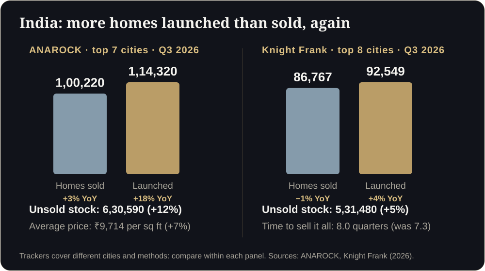

**Key takeaways**

- A 2D plan answers the architect's questions, not the buyer's: is it big enough, where does the light fall, will my furniture fit?
- India has seen launches outrun sales for 16 straight quarters, so buyers compare many projects. The one they understand fastest gets the site visit.
- Regulators in Maharashtra and Dubai now expect verifiable information in every advert. A 3D flat adds clarity on top of compliance, it does not replace it.
- Research on virtual tours is mixed on price but supportive on better-informed buyers. Promise clarity and speed, not miracles.

Picture thisIt is 11 pm. A buyer opens your brochure on her phone. She sees a plan with a dozen rooms, tiny labels and no way to tell if the master bedroom fits a king bed. She closes it, and opens the next project's link. You will never know she was there.

<b>16</b>straight quarters of launches above sales (Knight Frank)

<b>6.3 lakh</b>unsold homes, top 7 cities (ANAROCK, Q3)

<b>8.0</b>quarters to sell the stock at today's pace

<b>29%</b>ready-home share of Dubai sales in Q3

A 2D floor plan is an exact document, and that is its problem. It tells an architect everything and a buyer almost nothing. Most people cannot tell from lines and labels whether a living room will feel generous, where the afternoon sun lands, or whether their sofa will fit.

## The questions a floor plan cannot answer

- Does this room still feel big once furniture is in it?
- Which rooms get morning light, and which get the afternoon heat?
- What will I see from the balcony?
- How does the kitchen connect to the dining area in daily life?
- Is this layout better than the one I saw yesterday?

When buyers cannot answer these, they do one of three things: delay, ask for a discount to cover the uncertainty, or move to a project that is easier to understand. None of them help you.

## Why this matters more in 2026

In India's top eight cities, launches exceeded sales for the 16th consecutive quarter in Q3 2026. Unsold stock stands at about 5.3 lakh homes, and Knight Frank estimates it would take 8.0 quarters to sell out at the current pace. ANAROCK counts about 6.3 lakh unsold homes across its top seven cities at the end of Q3 (up 12% on the year), even though sales rose 3% and launches jumped 18%.

In Dubai, off-plan is still the largest residential segment, with AED 41.58 billion across 23,457 deals in Q3. But betterhomes reports the ready-home share rising from 24% to 29% and calls the market more selective.

In both markets, buyers have plenty of choice. The project that is easiest to understand gets the visit.

<figure class="fig"><figcaption>India, Q3 2026: launches again outran sales, and unsold stock keeps building.</figcaption></figure>

## Regulators are moving toward verifiable information

In Maharashtra, every project promotion has had to carry the MahaRERA registration number and QR code since 1 August 2023, and MahaRERA has penalised hundreds of projects for leaving them out. In Dubai, property advertisements need a valid advertising permit (Trakheesi) number. Buyers are being trained to expect proof.

A walkable 3D flat does not replace any of that. Keep the registration number, QR code and permit number visible next to it. What the 3D flat adds is the thing a QR code cannot give: a feel for the space.

## What the research actually says

A UK study reported by The Negotiator linked guided virtual viewings to 19.4% higher conversion and roughly 5.6% higher sale prices. A Harvard Business School study of more than 75,000 home sales found no significant price effect from virtual tours once photo quality and listing details were controlled for, although tours did help buyers screen out homes that were not a fit.

Both studies cover homes that already exist. For a flat that is not built yet, the buyer has no physical alternative, so the case for an interactive walkthrough is arguably stronger. Treat that as a hypothesis to measure in your own project, not as a promise.

<aside class="inline-cta" markdown="0">

See your own floor plan in 3D

Send one floor plan (up to 1,500 sq ft) and we will turn it into a walkable 3D flat that opens from one link on any phone. Free first floor, no app needed.

<a class="cta" href="#get-demo" data-track="post_inline_cta" data-label="Get my free 3D demo">Get my free 3D demo</a><a class="btn-ghost" href="https://app.sandmotion.in/" target="_blank" rel="noopener" data-track="live_demo_click" data-label="inline">Try the live demo</a>

</aside>

<figure class="fig"><figcaption>From floor plan to one shareable link.</figcaption></figure>

## What to show instead: three layers

1. **The 2D plan** for dimensions, compliance and architects.
2. **An interactive 3D walkthrough on one link** for understanding.
3. **Three or four hero stills** for ads and WhatsApp previews.

Send the link first and the PDF second. Buyers who open the link and walk through are the ones who ask better questions on the site visit.

## How to start without a big budget

Pick your best-selling unit type and model that one first. Track whether the buyers who open it ask different questions, book faster or visit more prepared. If the signal is there, extend it to other unit types and floors.

Related reading: [Why App-Free 3D Walkthroughs Win More Buyer Attention]() and [Selling Off-Plan in Dubai]().

## A 10-minute floor plan audit

Open your best-selling unit plan and tick what is true today.

## Copy-paste: the message to send with your plan

WhatsApp, first replyHi {name}, thanks for your interest in {project}. Here is the plan, and a walkable version you can open on your phone: {link}. Tell me which room matters most to you and I will show you the best way to see it.

Do we still need the 2D plan?

Yes. It is your legal and technical reference, and architects, banks and regulators expect it. The point is to stop using it as the only thing a buyer sees.

How much does it cost to add a 3D link?

It depends on unit types and finish level. Read our 3D walkthrough cost guide for published ranges in India, Dubai and worldwide, then ask for a written quote.

## Sources

- [Knight Frank India, Q3 2026 residential report (via Gulf Today)](https://www.gulftoday.ae/business/2026/10/24/indias-residential-market-holds-steady-in-third-quarter-of-2026)
- [ANAROCK, Q3 2026 housing data (via The Realty Today)](https://therealtytoday.com/news/news/q3-2026-housing-sales-rise-3-y-o-y-in-top-7-cities-new-launches-up-18/)
- [Dubai Land Department Q3 2026 transactions (via Zawya)](https://www.zawya.com/en/press-release/research-studies/dubai-real-estate-transactions-reach-aed-90.62bln-in-q3-as-off-plan-remains-the-largest-residential-segment-1510107)
- [betterhomes Q3 2026 report (via Khaleej Times)](https://www.khaleejtimes.com/business/property/dubai-ready-home-sales-jump-16-as-buyers-shift-away-from-off-plan-properties)
- [MahaRERA QR code order, mandatory from 1 August 2023 (Housing.com)](https://housing.com/news/qr-code-display-in-all-maharera-registered-projects-mandatory-from-aug-1-2023/)
- [MahaRERA fines 628 projects for missing QR code and registration number (Housing.com)](https://housing.com/news/maharera-fines-628-projects-for-not-displaying-qr-code-registration-number/)
- [Complete guide to the Trakheesi system in Dubai (Bayut)](https://www.bayut.com/mybayut/trakheesi/)
- [twentyci virtual viewings research (via The Negotiator)](https://thenegotiator.co.uk/virtual-viewings-research-twentyci/)
- [Harvard Business School, Are Virtual Tours Still Worth It? (75,000 home sales)](https://www.library.hbs.edu/working-knowledge/are-virtual-tours-still-worth-it-in-real-estate-evidence-from-75000-home-sales)

*Figures are as reported by the sources above at the time of writing (October 2026). Check the latest releases before quoting them.*
