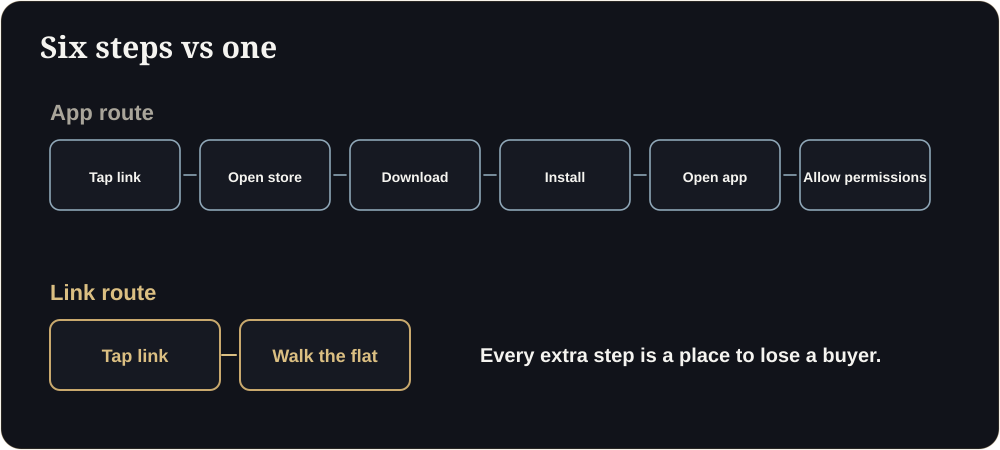

**Key takeaways**

- Every step you add between 'interested' and 'looking at the flat' loses buyers. Downloads and logins are the most avoidable steps.
- Property links travel on WhatsApp. A walkthrough that opens in the browser from one tap can be forwarded to a spouse, a parent or a broker in seconds.
- Use five simple tests to check if a 3D vendor is genuinely app-free.
- App-free does not mean low quality: it means the heavy lifting is optimised so the buyer never sees it.

What good looks likeA broker in Dubai forwards your project link to a client in London at 9 pm. The client taps it on an iPhone, expects a brochure, and lands inside a flat. No download, no login. He forwards it to his wife before dinner. That is how deals move now.

<b>1</b>tap from message to inside the flat

<b>0</b>apps, logins or plug-ins

<b>2</b>people who can open it in the next minute: anyone you forward it to

Real estate tools have a habit of asking buyers to work. Install this viewer. Create an account. Download a 200 MB file. Every one of those steps is a place where a casually interested buyer quietly leaves.

## Why friction costs more in property than in most industries

A property purchase is a group decision. The person who first sees your project is often not the person who signs. A buyer in Mumbai will forward the link to a spouse. An NRI in Dubai will send it to parents in Pune. A broker will pass it to five clients. Whatever you send has to survive being forwarded on WhatsApp to someone who has never heard of you.

A PDF survives that. A link that opens in the browser survives that. A link that says "download our app first" does not.

<figure class="fig"><figcaption>Every extra step is a place to lose a buyer.</figcaption></figure>

## What "app-free" really means

- The walkthrough opens in the phone's normal browser (Chrome, Safari, Samsung Internet).
- No account, login or email is required to look around.
- It works on the phones your buyers actually own, including mid-range Android.
- The link previews nicely in WhatsApp, with a real room image, not a blank card.
- It still works when the buyer is on a patchy mobile connection.

## Five tests you can run in ten minutes

1. **The stranger test.** Send the link to someone who has never seen it. Can they start walking in one tap?
2. **The forward test.** Forward it on WhatsApp. Does the preview look professional?
3. **The cheap phone test.** Open it on an older Android phone over mobile data.
4. **The airplane test.** Open it, switch to airplane mode, keep exploring. Does it recover gracefully?
5. **The vendor test.** Ask the vendor for the load time on a mid-range phone over 4G, and ask them to show it to you live, not in a video.

<aside class="inline-cta" markdown="0">

Test the link on your own phone

Open the live demo, forward it on WhatsApp, and see how it feels to your buyers. Then send us one floor plan and we will build yours free.

<a class="cta" href="#get-demo" data-track="post_inline_cta" data-label="Get my free 3D demo">Get my free 3D demo</a><a class="btn-ghost" href="https://app.sandmotion.in/" target="_blank" rel="noopener" data-track="live_demo_click" data-label="inline">Try the live demo</a>

</aside>

<figure class="fig shot"><figcaption>A real screenshot from a Sandmotion walkthrough: the buyer walks the flat in the browser.</figcaption></figure>

## "But will it look as good as an app?"

Modern browsers run real-time 3D natively through WebGL, and WebGPU is arriving. The trade-off is engineering effort: the model must be optimised (compressed geometry, smart textures, baked lighting) so it loads quickly. That is work the studio does once so every buyer gets a smooth experience. Heavier, cinematic experiences streamed from a server still have a place for sales galleries and flagship launches, and we cover when in [our guide to choosing the right 3D technology]().

## Where an app still makes sense

If you are running a branded, repeat-use portal for existing owners (service requests, handover tracking), an app can be justified. For attracting and convincing a first-time buyer, a link wins.

## Try it yourself

Open our live demo on your own phone. Time how long it takes from tap to walking, then send the link to someone and ask what they thought. If you like it, we will build your first floor free.

## Brief your vendor in five lines

Copy into your brief1) It must open in the phone's normal browser from one link. 2) No account or app. 3) First interaction in about 3 seconds on a mid-range Android over 4G, shown live. 4) WhatsApp preview with a real room image. 5) A fallback (360 images and a WhatsApp button) if 3D is not supported.

## Audit your current links

Will an app-free walkthrough look worse?

Not if it is optimised well. Modern browsers run real-time 3D natively, and good studios compress models and bake lighting so it stays smooth on mid-range phones.

Is there a case for an app?

For owners who use a portal repeatedly (service requests, handover tracking), yes. To attract and convince a first-time buyer, a link wins.

## Sources

- [Google, Core Web Vitals thresholds (web.dev)](https://web.dev/articles/vitals)

*Figures are as reported by the sources above at the time of writing (October 2026). Check the latest releases before quoting them.*
