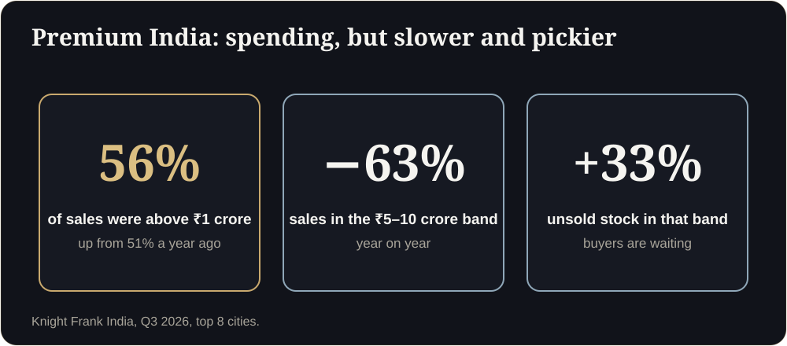

**Key takeaways**

- Premium buyers in India got more cautious in 2026: Knight Frank reports ₹5 to 10 crore sales falling 63% year on year while unsold stock in that band rose 33%.
- Luxury buyers judge projects by how they are treated before they buy: speed, clarity and honesty are signals of quality.
- A premium digital experience is one the buyer never has to figure out: one link, accurate scale, real materials, honest views.
- In Dubai, ready homes are taking share from off-plan, so premium launches need to remove doubt, not add spectacle.

The luxury shortlistA buyer shortlists three ₹6 crore apartments. All three have glossy renders. Only one lets her stand on the balcony at 6 pm and see the actual view from that floor. The other two get a polite reply. She has never needed a bigger chandelier, she needed an answer.

There is a common belief in luxury real estate marketing that more is better: more marble in the render, more drone footage, more animation, more effects. In 2026, buyers are moving the other way.

## The premium market is more careful than it looks

Knight Frank's Q3 2026 data shows homes priced above ₹1 crore making up 56% of sales in India's top eight cities, up from 51% a year ago. But inside that, the ₹5 to 10 crore band saw sales fall 63% year on year, with unsold stock in that band up 33%. Buyers at the top end are still spending, but they are slower, pickier and better informed.

In Dubai, the picture is similar in a different way. Off-plan remains dominant at AED 41.58 billion in Q3 deals, but ready-home share is rising and betterhomes describes a more selective phase. Developers are mostly holding prices, so projects need to win on confidence, not on discounts.

<figure class="fig"><figcaption>Premium buyers are still spending, but they are slower and pickier.</figcaption></figure>

## What luxury buyers read as quality

Premium buyers do not only evaluate the home. They evaluate how the developer behaves before the sale. They notice:

- **Speed:** does the link open at once, or do they wait?
- **Honesty:** are the views, light and room sizes realistic?
- **Ease:** can their spouse open it on a different phone without help?
- **Respect:** no forced sign-ups, no pop-ups, no download walls.
- **Consistency:** does the digital experience match the brand of the sales gallery?

Every friction point is read as a hint about how the developer will treat them after the cheque clears.

## Clarity in practice

1. **One link, one tap.** The buyer should be inside the flat in seconds.
2. **True-to-scale rooms.** A flattering but inaccurate render is a liability.
3. **Real materials and light.** Marble that looks like marble, a sun path that matches the site.
4. **Honest views.** Show the view from the actual floor and facing, not a stock skyline.
5. **A clear next step.** One button to talk to a human on WhatsApp.

<aside class="inline-cta" markdown="0">

Make your premium launch easier to understand

We build true-to-scale, photoreal walkthroughs that open from one link. Send us one unit plan and we will show you how it feels on a phone.

<a class="cta" href="#get-demo" data-track="post_inline_cta" data-label="Get my free 3D demo">Get my free 3D demo</a><a class="btn-ghost" href="https://app.sandmotion.in/" target="_blank" rel="noopener" data-track="live_demo_click" data-label="inline">Try the live demo</a>

</aside>

## A note on spectacle

Cinematic fly-throughs have value in launch events and social media. But the buyer who is seriously shortlisting wants to walk the flat at their own pace and look where they want. Use cinematic content to attract attention and the interactive walkthrough to convert it.

## A quick luxury checklist

- Is the walkthrough on a link that carries your brand, not a vendor's?
- Does it show the actual views, floor by floor?
- Have you included your RERA number, QR code or Trakheesi permit number in the viewer where required?
- Can a buyer abroad open it without help?
- Is there a visible, human way to reach your team?

If you cannot tick all five, there is room to win.

## The luxury launch kit

| Asset | Standard | Luxury |
|---|---|---|
| Walkthrough | Furnished unit, sun slider | Level 4 fidelity, real view plates, material swaps |
| Stills | 4 hero images | 10 images, day and dusk, lifestyle props |
| Film | Reel | 60 to 90 second cinematic cut from the same model |
| Brand | Logo in viewer | Fully branded link, bilingual, concierge button |
| Proof | RERA number | RERA number, QR code, approvals page, delivery milestones |

## Check your premium experience

Do luxury buyers want video or interactive 3D?

Both, for different jobs. Video builds desire; interactive 3D answers doubts. Produce both from one model.

## Sources

- [Knight Frank India, Q3 2026 residential report (via Gulf Today)](https://www.gulftoday.ae/business/2026/10/24/indias-residential-market-holds-steady-in-third-quarter-of-2026)
- [Dubai Land Department Q3 2026 transactions (via Zawya)](https://www.zawya.com/en/press-release/research-studies/dubai-real-estate-transactions-reach-aed-90.62bln-in-q3-as-off-plan-remains-the-largest-residential-segment-1510107)
- [betterhomes Q3 2026 report (via Khaleej Times)](https://www.khaleejtimes.com/business/property/dubai-ready-home-sales-jump-16-as-buyers-shift-away-from-off-plan-properties)
- [fäm Properties, off-plan pricing analysis (via Khaleej Times)](https://www.khaleejtimes.com/dubai-developers-hold-off-plan-pricing-as-only-6-projects-cut-prices-by-5-or-more-since-february)
- [Complete guide to the Trakheesi system in Dubai (Bayut)](https://www.bayut.com/mybayut/trakheesi/)

*Figures are as reported by the sources above at the time of writing (October 2026). Check the latest releases before quoting them.*
