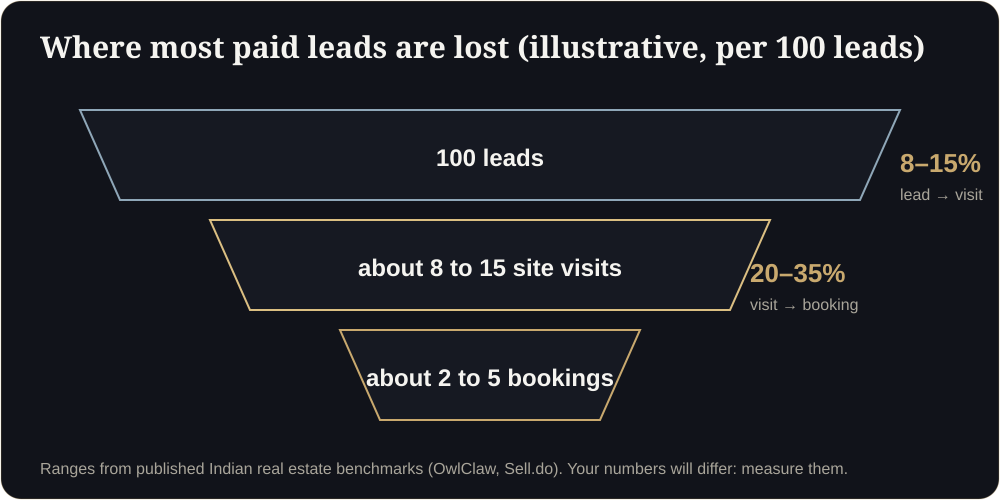

**Key takeaways**

- Industry benchmarks put lead-to-site-visit conversion at roughly 8 to 15% and visit-to-booking at 20 to 35% in India, so each step matters.
- Digital marketing costs are rising 20 to 30% a year, which makes leaking the leads you already paid for expensive.
- Seven steps decide the outcome: ad, landing page, understanding the product, first reply, site visit, follow-up, booking.
- Fix speed to first reply first. It is the cheapest improvement.

Small leaks, big moneyYou spend ₹5 lakh on ads and get 400 leads. About 40 become site visits and about 10 become bookings. Now imagine 4 more visits, only because your first reply came in five minutes and carried a walkable 3D flat. Nothing else changed.

When a developer says "we need more leads", the real problem is often the opposite: too many leads are leaking between the ad and the booking. Marketing costs have climbed, so every leak is more expensive than it used to be.

## The numbers behind the leak

Benchmarks published for Indian real estate put paid lead costs anywhere from ₹150 to over ₹2,000 per lead depending on channel and ticket size, and report lead-to-site-visit conversion around 8 to 15%, with 20 to 35% of site visits turning into bookings. exchange4media reports marketing costs rising by roughly 20 to 30% a year. These are broad ranges and your numbers will differ, but the shape is clear: most of what you pay for does not become a visit.

<figure class="fig"><figcaption>Where most paid leads are lost (illustrative).</figcaption></figure>

## The seven steps, and where buyers drop off

1. **The ad.** Does it show the product, or only a logo and a tagline?
2. **The landing page.** Does it load quickly on mobile, and is there one clear action?
3. **Understanding the product.** Can the buyer grasp the layout, light and size without a visit?
4. **The first reply.** How many minutes before a human responds?
5. **The site visit.** Is it booked with context, or cold?
6. **The follow-up.** Does the buyer get something useful after the visit, or just a call?
7. **The booking.** Is the path to token payment simple and trustworthy?

## Fix them in this order

**First: the first reply (step 4).** Reply on WhatsApp within five minutes during working hours. It costs nothing and often decides who gets the visit. Buyers enquire on several projects at once; the first useful answer sets the frame.

**Second: understanding the product (step 3).** If a buyer can walk through the flat on their phone before they visit, they arrive with better questions and fewer doubts. Your sales team spends time on the buyers who are serious.

**Third: the follow-up (step 6).** After a visit, send the walkthrough link with a short note. The buyer can share it with family, which is where much of the decision happens.

<aside class="inline-cta" markdown="0">

Give every enquiry something to open

We build a walkthrough link you can drop into your first WhatsApp reply. Send one floor plan and see how it feels.

<a class="cta" href="#get-demo" data-track="post_inline_cta" data-label="Get my free 3D demo">Get my free 3D demo</a><a class="btn-ghost" href="https://app.sandmotion.in/" target="_blank" rel="noopener" data-track="live_demo_click" data-label="inline">Try the live demo</a>

</aside>

## Metrics worth tracking

- Median minutes to first reply
- Cost per site visit (not just cost per lead)
- Share of leads that open the walkthrough
- Site-visit-to-booking rate, by source
- Cost per booking

Builders are moving from cost per lead to cost per site visit and cost per booking because those numbers decide profit. We cover this in [Pre-Sales at Speed]().

## A simple 30-day experiment

1. Pick one project and one lead source.
2. Set up a five-minute reply target on WhatsApp.
3. Add a walkthrough link to every first reply.
4. Measure visits and bookings against the previous 30 days.

You do not need a new tool to start. You need a clear first reply and something worth opening.

## The 5-minute reply: a one-page SOP

1. **Alert:** every new lead pings the sales manager's phone and a WhatsApp group.
2. **Reply:** the first message goes out within five minutes in working hours.
3. **Content:** greeting, one useful asset (the walkthrough link), one question.
4. **Handoff:** if no reply in 2 hours, call. If no pickup, send a voice note.
5. **Log:** the CRM records time to first reply for every lead.

First reply templateHi {name}, thank you for your interest in {project}. Here is a walkable version of the {unit_type} you can open on your phone: {link}. Which room matters most to you? I will show you the best way to see it, and can book a site visit this weekend if it feels right.

## Weekly funnel review (15 minutes)

What is a good lead-to-visit rate?

Published Indian benchmarks suggest roughly 8 to 15%, but it depends heavily on source, city and ticket size. Track your own and improve it against itself.

## Sources

- [Sell.do, paid lead generation for Indian real estate (2026)](https://www.sell.do/blog/paid-lead-generation-real-estate-india-2026)
- [OwlClaw, real estate marketing benchmarks (India)](https://owlclaw.com/benchmarks/real-estate-marketing-benchmarks)
- [exchange4media, real estate marketing spends surge](https://www.exchange4media.com/marketing-news/real-estate-marketing-spends-surge-but-are-returns-keeping-pace-154495.html)

*Figures are as reported by the sources above at the time of writing (October 2026). Check the latest releases before quoting them.*
