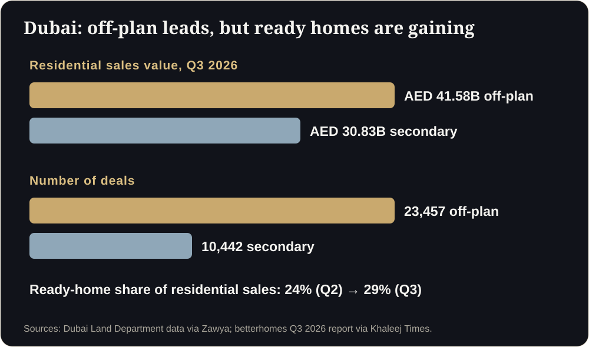
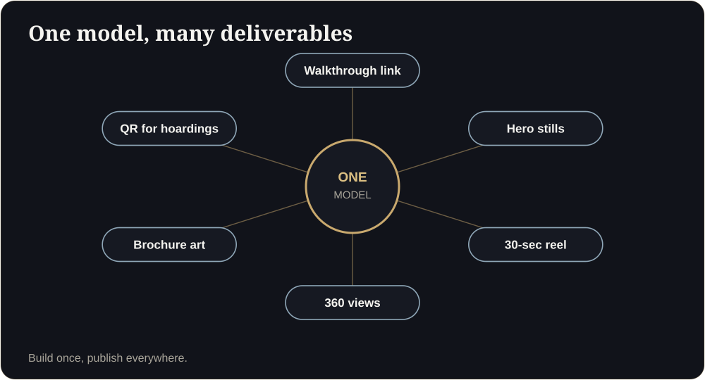

**Key takeaways**

- Dubai recorded AED 41.58B in off-plan residential sales across 23,457 deals in Q3 2026, but ready-home share rose to 29%.
- Studio apartments drove volume (up 26% in Jan to Aug), which means many buyers are investors comparing many launches remotely.
- A walkable unit helps brokers present several projects a day from a phone, and helps overseas buyers decide without a site visit.
- Every advert needs a valid Trakheesi permit number, including the ones that link to your walkthrough.

A Tuesday in DubaiA broker in Business Bay has twelve clients on WhatsApp, six projects to pitch and no time to visit a single site. He sends the same link to four of them: a walkable unit with the view from the 32nd floor. One calls back in ten minutes.

Dubai's off-plan market is still the biggest part of residential sales, but it is no longer easy. Buyers are comparing more, ready homes are taking share, and developers are mostly holding prices rather than cutting them. In that setting, how clearly you present an unbuilt home matters.

## The Dubai picture in 2026

According to Dubai Land Department data reported for Q3 2026, the emirate recorded AED 90.62 billion in transactions. Off-plan residential accounted for AED 41.58 billion across 23,457 deals, compared with AED 30.83 billion across 10,442 deals in the secondary market. betterhomes reports that ready-home sales rose 16% quarter on quarter and the secondary share climbed from 24% to 29%.

fäm Properties' analysis shows developer apartment sales of 62,147 units in January to August 2026, down 6%, with studios up 26% to 21,728 units while one-, two- and three-bedroom sales fell. It also found only 44 of 717 off-plan projects had cut prices by 5% or more since February, and that projects priced closer to market sold faster.

<figure class="fig"><figcaption>Dubai, Q3 2026: off-plan leads, ready homes are gaining share.</figcaption></figure>

## What that means for visualisation

- **Many buyers are remote investors.** They cannot walk the site, and they are often comparing a dozen launches on a phone.
- **Compact units dominate volume.** Studios and one-beds are about layout efficiency, which is exactly what a walkthrough shows well.
- **Developers are protecting price.** Price cuts are rare, so you win on confidence and clarity.
- **Brokers sell many projects.** They need assets that are fast, shareable and easy to compare.

## A practical off-plan presentation kit

1. A walkable model of each main unit type, with views by floor and facing.
2. A payment-plan overlay or a clear link to the payment plan.
3. Hero stills and a 30-second reel for social media.
4. English and Arabic interfaces for GCC buyers.
5. A single link per unit type that a broker can send on WhatsApp.

<aside class="inline-cta" markdown="0">

Planning a Dubai launch or listing?

Send us a unit plan and we will show you a walkable version, with English and Arabic options and a place for your Trakheesi number.

<a class="cta" href="#get-demo" data-track="post_inline_cta" data-label="Get my free 3D demo">Get my free 3D demo</a><a class="btn-ghost" href="https://app.sandmotion.in/" target="_blank" rel="noopener" data-track="live_demo_click" data-label="inline">Try the live demo</a>

</aside>

## Stay compliant: the Trakheesi permit

Dubai property advertising requires a valid advertising permit through the Trakheesi system, and the permit number must appear on the advert. A walkthrough link in a social post, an email or a broker's WhatsApp status is part of that advertising. Build a permit-number field into the viewer footer and agree with your marketing team who supplies it. Check the latest rules with the Dubai Land Department and your legal adviser, since requirements and penalties change.

<figure class="fig"><figcaption>One model feeds every channel a Dubai launch needs.</figcaption></figure>

## How brokers use it day to day

- Send the unit link in the first WhatsApp reply to an enquiry.
- Compare two projects by sending both links and asking which one feels right.
- Use it to pre-qualify: buyers who spend minutes inside are more serious.
- Share with family members in other countries so the decision is made together.

## Where to start

Choose one launch with a clear unit mix. Build the two highest-volume unit types first. Track whether enquiries that receive the link convert to calls and bookings at a different rate from enquiries that did not. If you are a broker, ask the developer for the walkthrough link, or tell us which project you are selling and we will show what a unit link could look like.

## Broker scripts for off-plan (copy and adapt)

First WhatsApp replyHi {name}, thanks for your enquiry on {project}. Here is a walkable version of the {unit_type} so you can see the layout and the view from your floor: {link}. Permit No: {trakheesi}. Would you like the payment plan and available floors?

Follow-up after 24 hoursHi {name}, did you get a chance to look inside the unit? Most clients tell me the balcony view decides it. If you share your budget and handover preference, I will shortlist two floors.

## Launch checklist for Dubai

Who needs a Trakheesi permit?

Property advertisements by developers and brokers need a valid permit, and the number must appear on the advert. Confirm current requirements with the Dubai Land Department and your legal adviser.

Do Arabic walkthroughs matter?

For GCC buyers, an Arabic option shows respect and removes friction. Offer English and Arabic where your buyer mix justifies it.

## Sources

- [Dubai Land Department Q3 2026 transactions (via Zawya)](https://www.zawya.com/en/press-release/research-studies/dubai-real-estate-transactions-reach-aed-90.62bln-in-q3-as-off-plan-remains-the-largest-residential-segment-1510107)
- [betterhomes Q3 2026 report (via Khaleej Times)](https://www.khaleejtimes.com/business/property/dubai-ready-home-sales-jump-16-as-buyers-shift-away-from-off-plan-properties)
- [fäm Properties, off-plan pricing analysis (via Khaleej Times)](https://www.khaleejtimes.com/dubai-developers-hold-off-plan-pricing-as-only-6-projects-cut-prices-by-5-or-more-since-february)
- [Complete guide to the Trakheesi system in Dubai (Bayut)](https://www.bayut.com/mybayut/trakheesi/)

*Figures are as reported by the sources above at the time of writing (October 2026). Check the latest releases before quoting them.*
