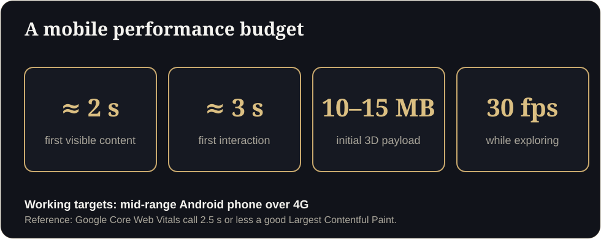

**Key takeaways**

- Google treats a page as having a good loading experience when the main content appears within 2.5 seconds (Core Web Vitals). Heavy 3D needs deliberate engineering to get near that.
- Our working target is a first interaction in about 3 seconds on a mid-range Android phone over 4G, with a smooth frame rate afterwards.
- Speed comes from compression, baked lighting, progressive loading and a lightweight poster image shown first.
- Ask vendors for a live test on a mid-range phone, not a video of a laptop.

Four secondsThe link opens. A grey bar appears. Four seconds pass. A buyer in a taxi switches back to WhatsApp and replies 'will check later'. Later never comes.

The first 3D experience a buyer opens on their phone sets the tone for your project. If it hangs on a loading bar, they do not think "the model is detailed". They think "this is slow" and close it.

## What counts as fast

Google's Core Web Vitals give useful reference points for web pages: a good Largest Contentful Paint is 2.5 seconds or less, a good Interaction to Next Paint is 200 milliseconds or less, and Cumulative Layout Shift should be 0.1 or less. A 3D viewer is heavier than a normal page, so the goal is practical: show something meaningful immediately and let the buyer start moving within a few seconds.

Our working targets for a residential walkthrough on a mid-range Android phone over 4G:

| Metric | Target |
|---|---|
| First visible content (poster image or simple scene) | Under about 2 seconds |
| First interaction (buyer can look around) | Around 3 seconds |
| Total initial 3D payload | About 10 to 15 MB compressed |
| Frame rate while exploring | 30 fps or better |
| Fallback if 3D is not supported | 360 images and a WhatsApp button |

These are working targets, not legal standards. The point is to set a number, measure it and improve it.

<figure class="fig"><figcaption>A practical performance budget.</figcaption></figure>

## Why heavy models load slowly

- Geometry that was exported straight from CAD or modelling software, with millions of unnecessary polygons.
- Uncompressed, oversized textures.
- Real-time lighting that a phone cannot afford.
- Everything loaded before the buyer is allowed to see anything.

## How good studios make it fast

1. **Optimise geometry.** Clean the model and use compressed mesh formats such as Draco or Meshopt.
2. **Compress textures.** Use formats such as KTX2 and sensible texture sizes.
3. **Bake lighting.** Pre-calculate light and shadow so the phone does not have to.
4. **Load progressively.** Show a poster image first, then a simple scene, then the full detail.
5. **Limit draw calls and use levels of detail.** Keep the scene light on the phone's graphics chip.
6. **Cache and preconnect.** Make repeat visits near-instant.

<aside class="inline-cta" markdown="0">

Time our demo on your phone

Open the live demo on a mid-range phone and see for yourself. Then send us one floor plan and we will build yours free.

<a class="cta" href="#get-demo" data-track="post_inline_cta" data-label="Get my free 3D demo">Get my free 3D demo</a><a class="btn-ghost" href="https://app.sandmotion.in/" target="_blank" rel="noopener" data-track="live_demo_click" data-label="inline">Try the live demo</a>

</aside>

## Five questions to ask any 3D vendor

1. What is your load time on a mid-range Android phone over 4G? Can you show me live?
2. What is the size of the initial download?
3. What frame rate do you target, and on which phones do you test?
4. What happens on a phone that cannot run 3D?
5. Does the link preview properly in WhatsApp?

## A ten-minute test you can run yourself

- Open the link on an older phone using mobile data, not Wi-Fi.
- Time it from tap to first movement.
- Rotate and walk for a minute. Does it stutter?
- Run the page through PageSpeed Insights and note the mobile score.
- Forward the link on WhatsApp and check the preview.

## Why speed is also a sales metric

A quick experience signals competence. Speed also affects how far a link travels: people forward things that open at once. If your walkthrough takes too long, it will not be forwarded, and the family discussion that closes a sale will happen without it.

Test our live demo on your own phone, time it, and tell us what you find. We would rather you measure than take our word for it.

## Performance test protocol (copy this)

1. Use an older Android phone on mobile data, Chrome, cleared cache.
2. Start a stopwatch when you tap the link.
3. Note: first visible content, first interaction, smooth walking at 30 fps.
4. Repeat three times and record the slowest result.
5. Run the page in PageSpeed Insights (mobile) and save the score.
6. Forward the link on WhatsApp and screenshot the preview.

## A clause for your vendor contract

Service clauseThe walkthrough shall present first visible content within about 2 seconds and allow first interaction within about 3 seconds on a mid-range Android phone over 4G, demonstrated live at acceptance, with an initial 3D payload of about 15 MB or less.

Why not just use a video?

Video is fine for ads. Buyers shortlisting a purchase want to look where they choose, which needs an interactive scene.

## Sources

- [Google, Core Web Vitals thresholds (web.dev)](https://web.dev/articles/vitals)

*Figures are as reported by the sources above at the time of writing (October 2026). Check the latest releases before quoting them.*
