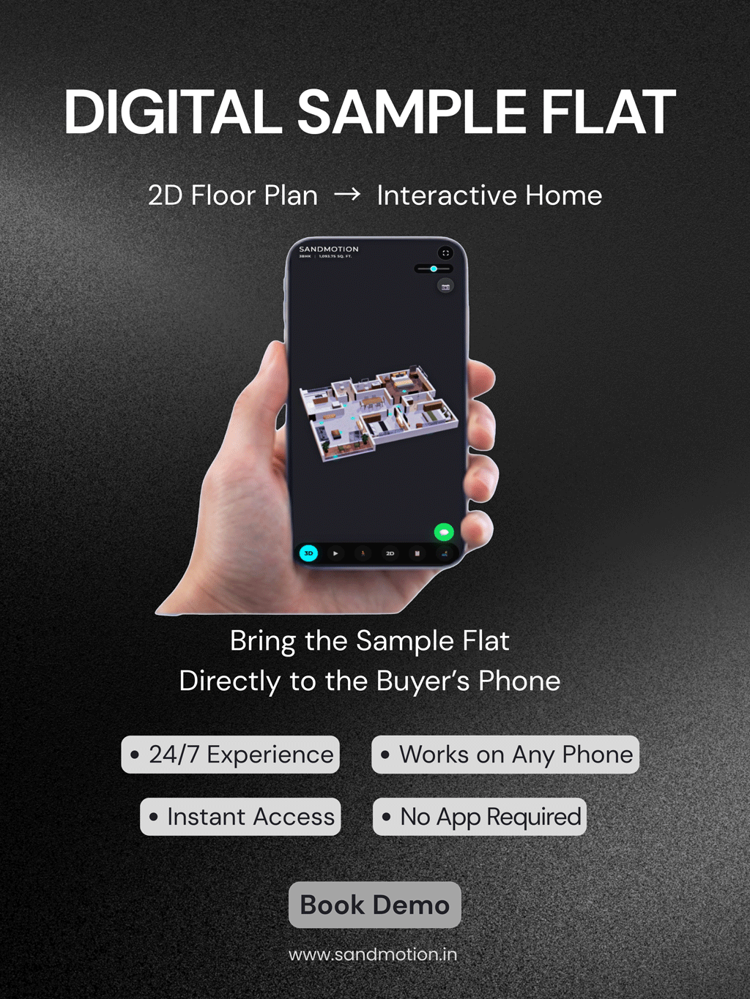

**Key takeaways**

- Off-plan buyers are buying things they cannot see: light, views, privacy and proportions. Naming and answering these doubts is your job.
- Eight questions drive most hesitation. Each can be answered with a specific feature: sun path, view plates, dimension overlays, compass.
- Accuracy beats beauty: a flattering view that does not match reality creates complaints later.
- Add 'artist's impression' disclaimers and your RERA or permit details where required.

The balcony questionA buyer on the 22nd floor asks one question: 'What will I see from the balcony?' Your brochure shows a skyline from a drone at 60 metres. She is buying at 66. Honest views are the cheapest way to earn trust.

When a buyer says "I need to think about it", they usually mean one of a handful of unanswered questions. In an unbuilt project, most of those questions are about things that cannot be seen on a drawing: light, view, privacy, proportion.

## The eight questions buyers carry

1. **Light:** What will the living room look like at 8 am and at 5 pm?
2. **View:** What will I actually see from the balcony on this floor?
3. **Proportion:** Does the room feel narrow or generous?
4. **Ceiling height and beams:** Will I feel boxed in?
5. **Furniture fit:** Will my sofa, bed and dining table fit?
6. **Privacy:** Who can see into my bedroom?
7. **Flow:** How do I move from the front door to the kitchen to the balcony?
8. **Orientation:** Which rooms face which direction? (Important to many Indian buyers for vastu preferences and for heat and light.)

## How a walkthrough answers each one

| Buyer question | What to show |
|---|---|
| Light | A sun slider based on the real location, date and time |
| View | View plates from the actual floor height and facing, using site photos or drone captures where possible |
| Proportion | True-to-scale rooms, with a dimension overlay on request |
| Ceiling height | Accurate heights, beams and false ceilings modelled |
| Furniture fit | Two or three furniture layouts to choose from |
| Privacy | Neighbouring blocks and the building's own geometry placed correctly |
| Flow | A walkable path from door to balcony without cuts |
| Orientation | A visible compass and room directions |

## Dubai and India: different priorities

In **Dubai** towers, the view is often the product: sea, skyline or canal, and the floor you choose changes it. Buyers abroad want to compare floors without flying in. In **India**, orientation, natural light and cross-ventilation are frequent deciding factors, along with the view over amenities and neighbouring plots.

<aside class="inline-cta" markdown="0">

See the light in your own unit

Send one floor plan and we will show how the sun path, views and furniture options look on a phone.

<a class="cta" href="#get-demo" data-track="post_inline_cta" data-label="Get my free 3D demo">Get my free 3D demo</a><a class="btn-ghost" href="https://app.sandmotion.in/" target="_blank" rel="noopener" data-track="live_demo_click" data-label="inline">Try the live demo</a>

</aside>

<figure class="fig"><figcaption>Views and light are added after the geometry is verified.</figcaption></figure>

## Accuracy beats beauty

A flattering view that does not match the real one creates complaints and disputes later. Good practice:

- Base views on real site data wherever possible.
- Show planned neighbouring buildings only if they are approved and known.
- Label visuals as an artist's impression where required.
- Keep your RERA registration number and QR code or Dubai permit number visible with the experience.
- Ask your lawyer to review the wording of disclaimers.

## What to measure

After launching a walkthrough with sun path and views, ask the sales team which questions buyers stopped asking and which new ones appeared. That tells you what to add next.

## Checklist for your next launch

- Sun path set to the real site location
- Views captured for at least three representative floors
- Dimensions checked against the approved plan
- Two furniture layouts per unit type
- Compass and orientation shown
- Disclaimers and registration details in place

If you want help turning these into a walkable experience, send us one unit plan and we will show you.

## Capture the site data that makes views honest

- Drone or crane photos at the real floor heights (three bands: low, mid, high).
- GPS coordinates and plot orientation for a true sun path.
- Heights and distances of neighbouring buildings (approved ones only).
- Photos of the horizon in all four directions.
- Date, time and weather of each capture.

<figure class="fig shot"><figcaption>A screenshot from a Sandmotion digital sample flat demo.</figcaption></figure>

## Pre-launch visual accuracy checklist

Can you show future neighbouring buildings?

Only approved, known ones. If the surroundings are uncertain, say so in the disclaimer rather than showing an open sky that may not last.

## Sources

- [MahaRERA QR code order, mandatory from 1 August 2023 (Housing.com)](https://housing.com/news/qr-code-display-in-all-maharera-registered-projects-mandatory-from-aug-1-2023/)
- [Complete guide to the Trakheesi system in Dubai (Bayut)](https://www.bayut.com/mybayut/trakheesi/)

*Figures are as reported by the sources above at the time of writing (October 2026). Check the latest releases before quoting them.*
