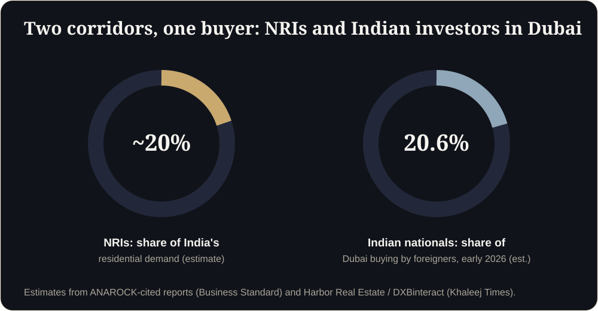

**Key takeaways**

- Estimates put NRIs at about one-fifth of India's residential demand, and Indian nationals were the top international investors in Dubai in early 2026.
- Remote buyers need three things: trust, understanding and a way to involve family across time zones.
- Build a remote kit: walkthrough link, verified project details, a short video call, clear documents and payment guidance.
- Never skip compliance: RERA details in India, advertising permits in Dubai, and legal guidance for cross-border purchases.

A family decision, remotelyIt is 10 pm in Dubai and a family is on a video call with parents in Pune. The son shares his phone screen. They walk through a flat that does not exist yet, argue happily about the kitchen, and the mother says, 'This one.' Nobody flew anywhere.

A growing share of property buyers will never stand in your sales gallery. They are in Dubai, London, Singapore or New York, and they are buying in Pune, Hyderabad or Dubai itself. Selling to them is a different job.

## The size of the opportunity

Industry estimates cited in the Indian press, based on ANAROCK research, put NRI buyers at roughly 20% of total real estate investment in India by the end of 2025, up from 10 to 15% earlier, with the US, UK, UAE, Canada and Singapore among the most interested countries. In Dubai, Indian nationals remained the top group of international investors in early 2026, with an estimated 20.6% of purchasing activity according to Harbor Real Estate, citing DXBinteract data. Treat these as estimates, but the direction is clear.

Some Indian developers are sending roadshow teams to Dubai, the UK, the US and Singapore. A roadshow reaches the people who come. A link reaches the people who do not.

<figure class="fig"><figcaption>Two corridors, one buyer: NRIs and Indian investors in Dubai.</figcaption></figure>

## What a remote buyer needs

- **Trust:** Is this developer real? Is the project registered? Who else is buying?
- **Understanding:** What will the home be like? What are the real room sizes and views?
- **Family involvement:** Parents, spouses and siblings in different countries must all be comfortable.
- **Process clarity:** Documents, payment, legal steps and timelines.

## The remote buyer kit

1. **A walkthrough link per unit type** that opens on any phone without an app.
2. **A short verified-information sheet:** registration number, approvals, payment plan, timelines.
3. **A scheduled video call** where a salesperson walks through the unit with the buyer, using the link.
4. **A family share:** one link that can be sent to relatives, with a way to ask questions.
5. **A simple document checklist** for the buyer's country and a recommendation to take legal advice.

<aside class="inline-cta" markdown="0">

Give overseas buyers a link they can trust

We build walkthroughs that open from one link anywhere in the world. Send a unit plan to see yours.

<a class="cta" href="#get-demo" data-track="post_inline_cta" data-label="Get my free 3D demo">Get my free 3D demo</a><a class="btn-ghost" href="https://app.sandmotion.in/" target="_blank" rel="noopener" data-track="live_demo_click" data-label="inline">Try the live demo</a>

</aside>

## Time zones and WhatsApp

Most remote buyers communicate on WhatsApp. Put the walkthrough link in the first message, then ask a simple question: "Which rooms matter most to your family?" Answer with the part of the walkthrough that addresses it.

Schedule calls in the buyer's evening and send a recap with the link afterwards. Remote decisions often take several family conversations, so what you send must work without you in the room.

## Compliance and caution

- In India, display the project's RERA registration number and, where applicable, the state's QR code in promotional material. In Maharashtra, the QR code and registration number are mandatory on advertisements.
- In Dubai, display the advertising permit number (Trakheesi) on property adverts.
- NRI purchases in India are subject to foreign exchange and banking rules. Do not give tax or legal advice: recommend a qualified adviser.
- Be accurate about what is built, approved and planned. Remote buyers rely on you more heavily.

## Content that builds trust abroad

- A short founder or sales-head video introducing the project.
- Progress updates with dated photos and a view of the same walkthrough updated over time.
- Clear answers to the ten most common NRI questions.

## Where to start

Pick one project with a good NRI fit, build the two most popular unit types, and run a four-week test: track enquiries from abroad, link opens, calls booked and bookings. Compare with the previous period.

## A 5-message WhatsApp sequence for remote buyers

Day 0Hi {name}, thank you for your interest in {project}. Here is a walkable version of the {unit_type}: {link}. Which rooms matter most to your family?

Day 1Hope you managed to look around. Many families like to walk through it together on a video call. Shall I set up 20 minutes this evening in your time zone?

Day 3Sending the one-page summary: registration details, approvals, payment plan, timeline: {pdf}. Happy to answer any questions from parents or advisers.

Day 6A few families have asked about floors and views. Here are the two best matches for your budget: {link1} and {link2}.

Day 10Would you like me to hold a unit while you decide? I can also introduce you to an adviser for the documentation steps from your country.

## Remote-buyer readiness

Do NRIs need a different walkthrough?

Usually the same model, with a family share option, and optional voice-over in the language they speak at home.

Is this legal and tax advice?

No. Recommend a qualified adviser for foreign exchange, tax and documentation questions.

## Sources

- [NRI demand for Indian homes, citing ANAROCK (Business Standard)](https://www.business-standard.com/markets/news/rupee-fall-boosts-nri-investments-in-luxury-and-ultra-luxury-properties-125030900443_1.html)
- [Indian, UK, Egyptian investors top Dubai property buyers in 2026 (Khaleej Times)](https://www.khaleejtimes.com/business/indian-uk-egyptian-investors-top-dubai-property-buyers-in-2026)
- [MahaRERA QR code order, mandatory from 1 August 2023 (Housing.com)](https://housing.com/news/qr-code-display-in-all-maharera-registered-projects-mandatory-from-aug-1-2023/)
- [Complete guide to the Trakheesi system in Dubai (Bayut)](https://www.bayut.com/mybayut/trakheesi/)

*Figures are as reported by the sources above at the time of writing (October 2026). Check the latest releases before quoting them.*
