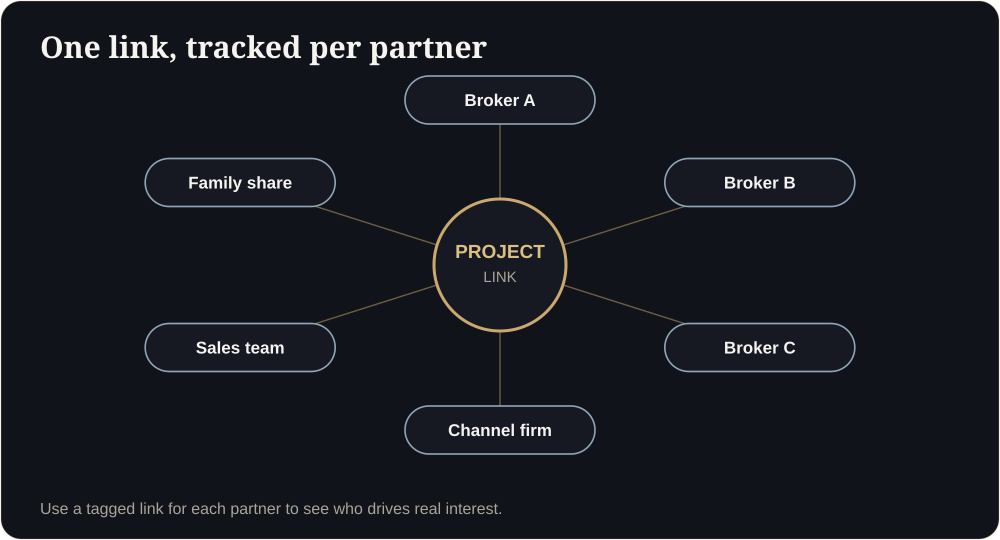

**Key takeaways**

- Brokers push the projects that are easiest to explain, send and follow up. Friction in your kit means fewer pitches.
- A modern kit has one link per unit type, a one-page fact sheet, price and availability, a WhatsApp script and an FAQ.
- Give each partner a trackable link so you can see who is generating real interest.
- Keep compliance details (RERA number, QR code, Dubai permit number) inside every asset.

Why partners skip projectsA channel partner has fifteen projects on her list. On Friday she has time to pitch three. She picks the ones whose links open in one tap, whose price sheet is current and whose layout she can explain without a site visit. The other twelve wait.

Most developers think of channel partners as a sales force. Brokers think of themselves as having a limited number of hours and a long list of projects to pitch. They choose the ones that are easy to understand, easy to send and easy to defend in front of a client.

## Why partners ignore some projects

- The brochure is a 50 MB file that will not send on WhatsApp.
- The layout is hard to explain without a site visit.
- Prices and availability are out of date.
- The broker cannot show the client what they are being asked to buy.
- There is no easy way to know whether the client opened anything.

## What a modern partner kit contains

1. **One walkthrough link per unit type.** Opens on any phone, no app.
2. **A one-page fact sheet:** location, configuration, carpet area, price range, payment plan, possession date, registration details.
3. **An availability and pricing sheet** that is current.
4. **Three or four hero stills** for status updates and ads.
5. **A WhatsApp script** the broker can adapt in thirty seconds.
6. **An FAQ** with honest answers on approvals, amenities, loans and timelines.
7. **A contact path** so the broker can pull in your sales head quickly.

<aside class="inline-cta" markdown="0">

Make your project easy for partners to sell

Send us a unit plan and we will build a link your channel partners can forward on WhatsApp in one tap.

<a class="cta" href="#get-demo" data-track="post_inline_cta" data-label="Get my free 3D demo">Get my free 3D demo</a><a class="btn-ghost" href="https://app.sandmotion.in/" target="_blank" rel="noopener" data-track="live_demo_click" data-label="inline">Try the live demo</a>

</aside>

## A WhatsApp script brokers can use

> Hi {name}, based on what you told me, I think this 2BHK could suit you. Please open this link on your phone and walk to the balcony: {link}. If it feels right, I can share the pricing sheet and book a visit this weekend.

Three lines: a reason, a link, a next step.

<figure class="fig"><figcaption>One link, tracked per partner.</figcaption></figure>

## Track what works

- Create a unique link (for example with a campaign tag) for each partner or partner firm.
- Track link opens, time spent and shares.
- Review weekly which partners generate real engagement and which just collect brochures.
- Reward the partners whose clients become site visits, not just those who send volume.

## Train the sales team in 30 minutes

- How to open and demonstrate the walkthrough.
- When to send it: after the first call, before the site visit, after the site visit.
- How to handle the three most common objections using the walkthrough.
- What to say about approvals, with the registration details on screen.

## Dubai-specific notes

- Brokers and developers need valid advertising permits (Trakheesi), and the permit number must appear on property adverts. Include it in the viewer footer and your status graphics.
- Many buyers are overseas and compare several projects on WhatsApp. Links that open quickly and look professional are your best chance of being compared favourably.
- Offer an Arabic and English option if you target GCC buyers.

## If you are a broker

Ask each developer you work with for a walkthrough link per unit type. If they do not have one, tell them buyers are asking for it. If you want to see what a unit link looks like, send us the plan of a project you are selling and we will show you.

## Partner kit scorecard

## A 30-minute partner briefing agenda

1. 5 min: project in one sentence and who it suits.
2. 10 min: open the walkthrough together; walk the best unit.
3. 5 min: price, payment plan, availability.
4. 5 min: three objections and how to answer them.
5. 5 min: the tagged link, who to call and when.

Message to a partnerHi {name}, we have a walkable version of {project} ready: {link}. It takes one tap, no app. I have added your tag so you can see when clients open it. Can we do a 20-minute briefing tomorrow?

How do I know which partner drives real interest?

Give each partner a unique tagged link and track opens, time spent and follow-up calls. Reward results, not volume.

## Sources

- [MahaRERA QR code order, mandatory from 1 August 2023 (Housing.com)](https://housing.com/news/qr-code-display-in-all-maharera-registered-projects-mandatory-from-aug-1-2023/)
- [Complete guide to the Trakheesi system in Dubai (Bayut)](https://www.bayut.com/mybayut/trakheesi/)
- [Sell.do, paid lead generation for Indian real estate (2026)](https://www.sell.do/blog/paid-lead-generation-real-estate-india-2026)

*Figures are as reported by the sources above at the time of writing (October 2026). Check the latest releases before quoting them.*
