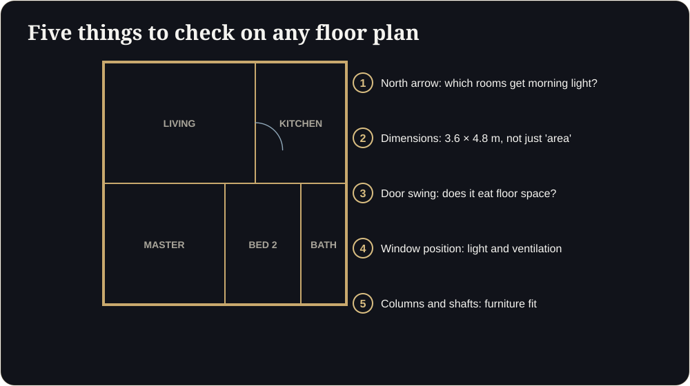

**Key takeaways**

- Under RERA, apartments are sold on carpet area: the net usable area inside the walls, including internal partitions but excluding external walls and exclusive balcony or terrace.
- Check dimensions, door swings, window positions, orientation and structural columns before you decide.
- Test furniture fit on paper, then confirm in 3D if the developer offers a walkthrough.
- Developers: share this guide with your leads. Buyers who understand the plan ask better questions and trust you more.

From pencil to tapA couple spends two hours reading a plan with a pencil, measuring the sofa, drawing arrows. They still hesitate. Then the developer shares a walkable version, and in five minutes they say, 'Now we understand.'

A floor plan holds a lot of information, but it is written in a language most buyers never learned. This guide explains how to read one, and what a 3D walkthrough shows that lines on paper cannot.

## Start with the area terms

- **Carpet area:** Under the RERA Act, the net usable floor area of an apartment. It excludes external walls, service shafts, the exclusive balcony or verandah and the exclusive open terrace, but includes the thickness of internal partition walls.
- **Built-up area:** Carpet area plus wall thickness and balconies. It is a market term.
- **Super built-up (saleable) area:** Built-up area plus a share of common areas such as lobbies and amenities. Also a market term.

Since RERA, projects are expected to state carpet area, so compare apartments on carpet area and price per carpet square foot.

<figure class="fig"><figcaption>Five things to check on any floor plan.</figcaption></figure>

## Read the plan in six steps

1. **Find the north arrow.** It tells you which rooms get morning light, afternoon sun and which balconies face the road or the garden.
2. **Check room dimensions, not only areas.** A 120 sq ft bedroom that is 8 ft by 15 ft behaves very differently from one that is 10 ft by 12 ft.
3. **Look at door swings and window positions.** Doors that open into the middle of a room reduce usable space. Windows tell you where light and cross-ventilation come from.
4. **Spot columns and shafts.** Structural columns and service shafts can interrupt furniture layouts.
5. **Trace the daily path.** Walk the route from entrance to kitchen to balcony. Is there a dead corridor?
6. **Check the wet areas.** Bathrooms, utility spaces and kitchens need ventilation and sensible placement of plumbing walls.

## The furniture test

Take the main furniture you own and measure it. Mark where the bed, wardrobe, sofa and dining table would go on the plan, drawn to scale. If you cannot do this in five minutes, ask for a walkthrough or a furnished layout.

## Questions to ask the developer

- Is this the carpet area from the registered plan?
- Which way does each room face?
- What are the ceiling heights, including under beams?
- What is the depth of the balcony and what is on the other side of the railing?
- Are the views shown in marketing material from this floor?

<aside class="inline-cta" markdown="0">

Give your buyers a plan they can walk

Turn your floor plan into a walkable 3D flat that helps buyers answer the questions a drawing cannot.

<a class="cta" href="#get-demo" data-track="post_inline_cta" data-label="Get my free 3D demo">Get my free 3D demo</a><a class="btn-ghost" href="https://app.sandmotion.in/" target="_blank" rel="noopener" data-track="live_demo_click" data-label="inline">Try the live demo</a>

</aside>

## What a 3D walkthrough adds

A walkthrough lets you do several of these checks without a ruler:

- Stand in the room and judge its feel and proportions.
- See the sun and shade at different times of day.
- Check the view from the actual balcony.
- Test whether a furniture layout works.
- Compare units side by side before visiting.

It is a visual aid, not a legal document. The registered plan and agreement remain the authority, and you should always read them carefully with a qualified adviser.

## For developers: turn this into a buyer-education asset

Buyers who understand the plan ask better questions and feel more in control. Share this guide with your leads, add your own project examples, and link each unit type to its walkthrough. Educated buyers are easier to convert and less likely to feel misled later.

If you would like a buyer-friendly, walkable version of your floor plan, send it to us and we will build the first floor free.

## Check your own plan (interactive)

Is carpet area enough to compare homes?

It is the right starting point under RERA, but also compare room dimensions, ceiling heights and layout efficiency. A larger carpet area with awkward rooms can feel smaller than a smaller, well-planned flat.

Can a 3D walkthrough replace the registered plan?

No. It is a visual aid. The registered plan and agreement remain the authority.

