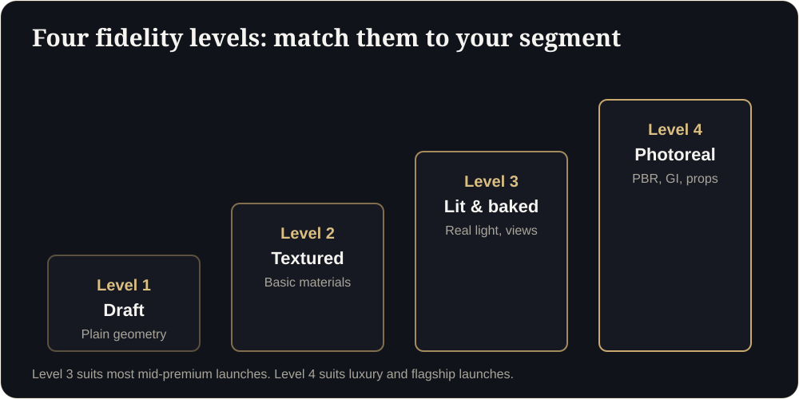
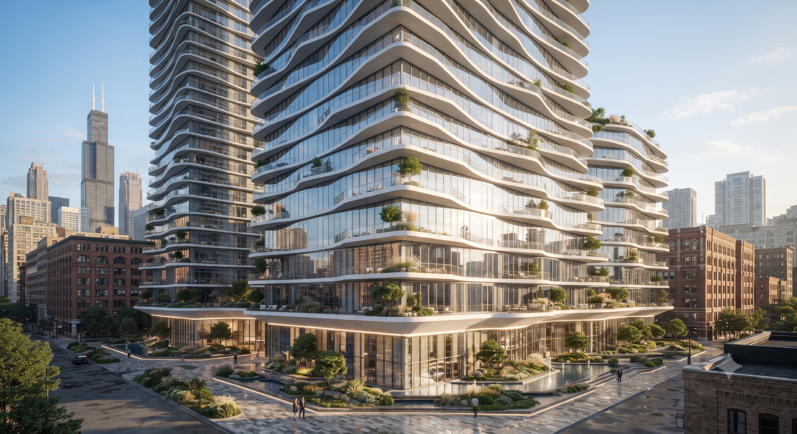

**Key takeaways**

- A walkthrough that looks 'good enough' can hurt a premium project, because buyers read it as a signal of how the building will be built.
- Judge quality on eight points: scale, light, materials, views, furnishing, polish, performance and compliance.
- Ask for a live test on your own plan, not a showreel of someone else's.
- Match the fidelity level to the segment: standard for volume projects, flagship quality for premium launches.

The only fair testTwo vendors quote for the same tower. One sends a showreel of cinematic renders. The other builds your best unit as a working demo in four days. Within one phone call you know which one understands buyers.

Every 3D vendor says "photorealistic". Very few define what that means. If you are buying a walkthrough for a project, here is how to judge what you are actually getting.

## Four fidelity levels

| Level | What it looks like | Typical use |
|---|---|---|
| 1. Draft | Plain geometry, flat colours | Internal design checks only |
| 2. Textured | Basic materials and furniture, simple sky | Budget previews, quick client reviews |
| 3. Lit and baked | Baked lighting and shadows, believable materials, real window views | Most mid-premium launches |
| 4. Photoreal | Physically based materials, accurate reflections, global illumination, props, plants and people | Luxury and flagship launches |

Match the level to the segment. Premium buyers will compare your walkthrough with the best they have seen, so do not send a Level 2 experience for a Level 4 price tag.

<figure class="fig"><figcaption>Match fidelity to your segment.</figcaption></figure>

## The 8-point checklist

1. **Scale accuracy.** Are rooms built to your approved plan? Ask the vendor to state the tolerance and show a dimension check against carpet area.
2. **Lighting.** Does the light look natural and shift believably with time of day? Flat, shadowless interiors look cheap.
3. **Materials.** Do stone, wood, glass, paint and fabric look like what will be installed, with believable reflections and texture?
4. **Views.** Do windows and balconies show a realistic view from that floor and facing, not a generic sky?
5. **Furnishing and props.** Is furniture at the right scale and in a sensible layout? In India, are familiar items (modular kitchen, wardrobes, utility balcony, pooja space) represented correctly?
6. **Polish.** No floating objects, clipping walls, jittery movement or texture stretching.
7. **Performance.** Does it open quickly and run smoothly on a mid-range phone? See our [mobile speed guide]().
8. **Compliance and clarity.** Is there room for the RERA registration number and QR code, or Dubai permit number, and an artist's impression disclaimer?

<aside class="inline-cta" markdown="0">

Score us against this checklist

We will build your first floor free (up to 1,500 sq ft). Judge scale, light, materials and speed on your own phone.

<a class="cta" href="#get-demo" data-track="post_inline_cta" data-label="Get my free 3D demo">Get my free 3D demo</a><a class="btn-ghost" href="https://app.sandmotion.in/" target="_blank" rel="noopener" data-track="live_demo_click" data-label="inline">Try the live demo</a>

</aside>

<figure class="fig shot"><figcaption>Real-time interior: furniture, materials and light that buyers can walk through.</figcaption></figure>

## Questions to ask any vendor

- Can you build one unit from my plan so I can judge the quality?
- What software and pipeline do you use, and how do you optimise for mobile?
- How do you verify dimensions, and who signs off?
- How many rounds of revisions are included?
- How are plan changes priced after delivery?
- Where is my data stored, and can you sign an NDA?
- Can you show load time on a mid-range phone over 4G?

## Red flags

- A showreel of cinematic renders but no interactive demo.
- No clear delivery timeline or revision policy.
- Models that only run on a laptop or require an app.
- Vague answers on accuracy and ownership of files.
- Pricing that gives no breakdown.

## Score it yourself

Give each of the eight points a score from 1 to 5. A total above 32 is a strong result for a premium launch. Below 24, ask the vendor what they will change.

## Why this matters to your sales

Buyers cannot yet judge your concrete, but they can judge your walkthrough. A carefully built experience builds confidence in the developer. A careless one raises a doubt you then spend months trying to answer.

Send us one floor plan and we will build your first floor free, so you can score us against this checklist.

## Score any walkthrough (interactive)

## Request-for-quote template

Copy into an emailPlease quote for an interactive web walkthrough of the attached unit plan(s), including: furnished interior at Level 3 or 4 fidelity, sun path for the site location, view plates for floors {floors}, two furniture layouts, mobile performance target of about 3 seconds to first interaction on a mid-range phone over 4G, two revision rounds, hosting for 12 months and the price of plan changes after delivery. Please also share a live demo link from a previous project.

What fidelity level do we need?

Level 3 suits most mid-premium launches. Level 4 suits luxury and flagship launches, where buyers compare with the best they have seen.

