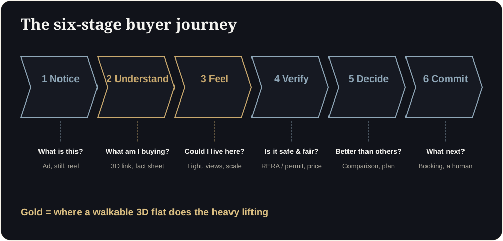

**Key takeaways**

- Buyers usually need two things before they commit: a feeling that this is the right home, and proof that the project is safe and fairly priced.
- Map the journey in six stages: notice, understand, feel, verify, decide, commit. Each needs a different asset.
- A walkthrough serves the 'understand' and 'feel' stages; RERA details, payment plans and comparisons serve 'verify' and 'decide'.
- Measure drop-off at each stage so you know which asset is missing.

Two questions, one buyerHer brother asks, 'But is it safe?' Her husband asks, 'But does it feel right?' One buyer, two questions, and two different assets needed in the next ten minutes: the registration proof and the walkthrough.

Sales teams argue about whether buyers decide with their hearts or their spreadsheets. In practice they need both. They want to feel that this is their home and to be able to defend the decision to their family, their bank and themselves.

## The six-stage buyer journey

| Stage | Buyer's question | Asset that helps |
|---|---|---|
| 1. Notice | What is this project? | A clear ad, hero still, short reel |
| 2. Understand | What exactly am I being offered? | Walkthrough link, fact sheet, floor plan |
| 3. Feel | Could I live here? | Light, views, scale and furniture options in 3D |
| 4. Verify | Is it safe, legal and fairly priced? | RERA registration and QR code, approvals, price per carpet sq ft, comparison |
| 5. Decide | Is this better than the alternatives? | Side-by-side comparison, payment plan, honest answers to objections |
| 6. Commit | What do I do next? | A simple booking path and a human to talk to |

<figure class="fig"><figcaption>The six-stage buyer journey.</figcaption></figure>

## Where most projects are weak

Many projects are strong at stage 1 (glossy ads) and stage 6 (a booking form) and weak in the middle. The buyer is left to piece together understanding, feeling and verification themselves. That is where they leave.

## Feeling is not decoration

Feeling does real work in a property decision. When a buyer can stand in a room in 3D and see the light fall across it, they have tested something a plan cannot show. They also begin to picture daily life in it, which is hard to unlearn. This is why we focus on light, scale, views and flow rather than on effects.

## Proof is not paperwork

Verification is an emotional need too: buyers want to feel safe. Make the proof visible:

- Registration number and QR code on every asset in Maharashtra, and permit numbers on Dubai adverts.
- Approvals and timelines in plain language.
- A clear price-per-carpet-area comparison.
- Honest statements of what is built, approved and planned.

<aside class="inline-cta" markdown="0">

Fill the missing stage in your buyer journey

Add a walkable 3D flat to your first reply and see how buyers respond. Free first floor.

<a class="cta" href="#get-demo" data-track="post_inline_cta" data-label="Get my free 3D demo">Get my free 3D demo</a><a class="btn-ghost" href="https://app.sandmotion.in/" target="_blank" rel="noopener" data-track="live_demo_click" data-label="inline">Try the live demo</a>

</aside>

## What the evidence says

The research on virtual tours is nuanced. A Harvard Business School study of 75,000 sales found no significant price premium from tours but showed they helped buyers screen out homes that did not suit them. A UK trial reported by The Negotiator linked guided virtual viewings to higher conversion. Taken together, the most defensible claim is that interactive visuals help the right buyers self-select and decide faster, not that they magically raise prices.

## Diagnose your own journey

1. Choose a project and list the assets you have for each of the six stages.
2. Mark any stage where the buyer has nothing to open or read.
3. Check your CRM: where do leads stop responding?
4. Build the missing asset for the weakest stage first.

## A small example

A developer notices that many leads ask for site visits but few book. The missing stage is "feel": buyers have seen ads and read the brochure, but not experienced the layout. The fix is a walkthrough link in the first WhatsApp message, with a follow-up asking which room mattered most. Visits become better prepared, and the sales team spends time on buyers who are ready.

Related reading: [Cut Buyer Friction]() and [PDF Brochure vs Interactive 3D]().

## Find your weakest stage

Do buyers decide with emotion or logic?

Most need both: a feeling that it is the right home and proof that it is safe and fairly priced. Design assets for both.

## Sources

- [Harvard Business School, Are Virtual Tours Still Worth It? (75,000 home sales)](https://www.library.hbs.edu/working-knowledge/are-virtual-tours-still-worth-it-in-real-estate-evidence-from-75000-home-sales)
- [twentyci virtual viewings research (via The Negotiator)](https://thenegotiator.co.uk/virtual-viewings-research-twentyci/)
- [MahaRERA QR code order, mandatory from 1 August 2023 (Housing.com)](https://housing.com/news/qr-code-display-in-all-maharera-registered-projects-mandatory-from-aug-1-2023/)
- [Complete guide to the Trakheesi system in Dubai (Bayut)](https://www.bayut.com/mybayut/trakheesi/)

*Figures are as reported by the sources above at the time of writing (October 2026). Check the latest releases before quoting them.*
