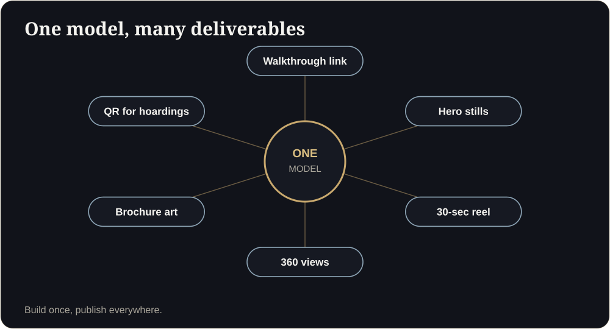

**Key takeaways**

- No single technology is best. Browser-based WebGL is the best default for sharing with many buyers; pixel streaming suits flagship events; video and 360 suit ads.
- Gaussian splatting captures real places beautifully, but an unbuilt building has nothing to capture, so it is a niche tool for now.
- Cost differs sharply: browser 3D runs on the buyer's device, streaming needs a GPU server for every session.
- The same technology powers industrial digital twins: CAD in, interactive 3D out.

Two correct answersAn architect wants the highest possible fidelity for a launch event. A developer wants one link for ten thousand buyers. Both are right, and both need different technology.

"Which 3D technology should we use?" is the question every developer and every manufacturer eventually asks. The honest answer is that it depends on who is looking, on what device, and how many people at once.

## The five options

| Option | How it works | Strengths | Limits | Best for |
|---|---|---|---|---|
| **Browser 3D (WebGL, soon WebGPU)** | Runs on the viewer's phone or laptop from a link | No server cost per viewer, instant sharing, works at scale | Needs careful optimisation for low-end phones; lighting is usually baked | Sharing with many buyers and partners |
| **Unreal Engine with pixel streaming** | A GPU server renders and streams video to the viewer | Highest visual fidelity, ray-traced looks | GPU cost per concurrent user, latency, harder to scale | Sales galleries, kiosks, flagship launches |
| **Walkthrough video** | Pre-rendered animation | Familiar, great for ads | Passive; expensive to change | Reels, launch events |
| **360 panoramas** | Pre-rendered views you jump between | Cheap, fast, ad-friendly | Not free walking | Social media, fallback for weak devices |
| **Gaussian splatting and scans** | Photoreal capture of an existing space | Stunning for built places | Needs a real space or AI generation; early-stage for tooling | Ready homes, completed model flats |

## Why the browser is the default

A property link has to survive being forwarded: to a spouse, a parent, a broker, an investor in another country. Browser-based 3D opens from a link on the phone they already have and costs you nothing extra when a thousand people open it. That is the main reason we build on it. The trade-off is craft: the scene must be optimised so it runs smoothly on a mid-range phone.

## When pixel streaming earns its place

Streaming from a GPU server can deliver extremely detailed, cinematic experiences on any device because the device is only playing video. But every concurrent viewer needs server capacity, and latency in some regions can be noticeable. That makes it a strong choice for controlled settings: a sales gallery, a launch event, an investor presentation. For mass sharing the economics are harder.

<aside class="inline-cta" markdown="0">

Not sure which 3D approach fits?

Tell us who needs to see your project and on which devices. We will recommend the right approach and show you a working example.

<a class="cta" href="#get-demo" data-track="post_inline_cta" data-label="Get my free 3D demo">Get my free 3D demo</a><a class="btn-ghost" href="https://app.sandmotion.in/" target="_blank" rel="noopener" data-track="live_demo_click" data-label="inline">Try the live demo</a>

</aside>

## What about Gaussian splatting?

Gaussian splatting reconstructs a real place from photos or video and renders it with striking realism in the browser. It is already used to show built homes. For an unbuilt building there is no physical space to capture, so splats would have to be generated from a model, which is not yet a standard production workflow. We watch it closely and use it where a completed show flat or a built reference exists.

## A decision guide

- **You need to send one link to hundreds of buyers and partners:** browser 3D.
- **You are staging a high-end launch event:** pixel streaming plus browser 3D for follow-up.
- **You need social media and ad creatives:** stills and a short video from the same model.
- **You are selling a completed, ready home:** a scan or capture-based tour may be enough.
- **You have weak internet audiences:** include a 360 fallback.

<figure class="fig"><figcaption>One model, many outputs.</figcaption></figure>

## One model, many outputs

The most cost-effective approach is to build one accurate model and produce everything from it: the walkthrough link, hero stills, a short reel, 360 images, brochure visuals and QR assets. Each output serves a different stage of the buyer journey.

## Beyond real estate

The same pipeline works for industrial assets. A CAD or BIM model of a plant, machine or building can be optimised into a browser-based digital twin, then extended with data overlays or AR and VR training. We explain how in [From CAD to Browser]().

If you are not sure which approach fits your project, send us a plan and tell us who needs to see it. We will recommend one.

## Cost drivers to ask about

- **Concurrent users** (streaming needs a GPU server per viewer).
- **Update frequency** (each change should not mean a full re-render).
- **Devices** to support (low-end Android included?).
- **Regions** where latency matters.
- **Data and analytics** you want back.

## What to avoid

- Choosing technology before knowing who needs to see it.
- Paying for streaming when a link would do.
- Accepting a demo that only runs on a laptop.

Is Unreal Engine better than WebGL?

Neither is better in general. Unreal can deliver the highest fidelity, but streaming costs scale with viewers. WebGL runs on the viewer's device and scales cheaply.

What about VR headsets?

They add wow at events but reach few buyers. Treat them as an extra, not the main channel.

