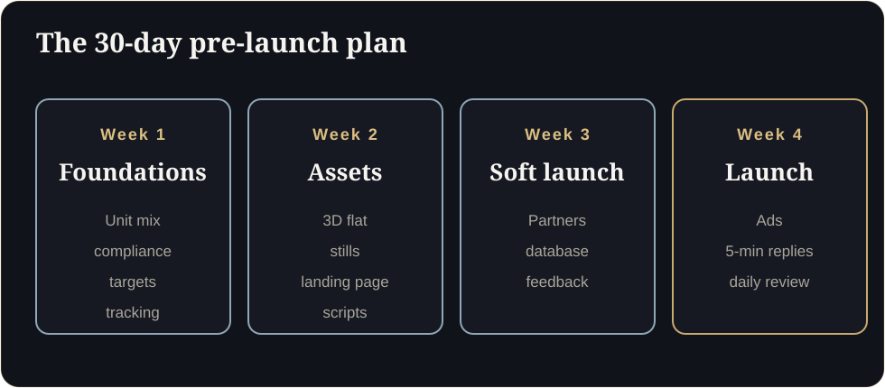

**Key takeaways**

- In markets such as Mumbai, Dubai and Singapore, selling before completion is normal, and competition for attention is high.
- A 30-day plan in four weeks: foundations, assets, soft launch and public launch with measurement.
- Track cost per site visit and cost per booking, not only cost per lead.
- Compliance is part of the plan: RERA registration and QR code in India, advertising permits in Dubai.

Why checklists winThe launch is in 30 days. The brochure is ready, the ads are booked, and no one has tested the first reply on WhatsApp. On day 1 you discover the permit number is missing from half the creatives. This plan exists so that day 1 is boring.

Real estate used to follow a simple order: build, then sell. Today, developers in cities such as Mumbai, Dubai and Singapore routinely sell homes months or years before completion. That makes the pre-launch period the most important marketing window you have.

Here is a 30-day plan that works for most residential launches. Adapt the details to your market.

<figure class="fig"><figcaption>The 30-day pre-launch plan.</figcaption></figure>

## Week 1: Foundations

- **Define the unit mix** and choose the two or three unit types that will drive most sales.
- **Confirm compliance:** RERA registration and state QR code (India), or advertising permits (Dubai) for every asset you plan to publish.
- **Set targets:** number of site visits, bookings and the cost per site visit you can afford.
- **Prepare your sales team:** a one-page fact sheet, price and payment plan, and honest answers to the five most common objections.
- **Set up tracking:** a CRM with clear stages, UTM tags for every source and a reporting sheet.

## Week 2: Build the assets

- **Interactive 3D walkthrough** for each main unit type, with sun path, views and furniture options.
- **Hero stills and a short reel** for ads and social media.
- **Landing page** that loads quickly on mobile and has one clear action.
- **WhatsApp scripts** for first reply, follow-up and site-visit confirmation.
- **Partner kit:** link, fact sheet, pricing sheet, FAQ.

## Week 3: Soft launch to partners and your database

- Send the partner kit to your top 20 channel partners and brief them in a short call.
- Message your existing database: previous buyers, enquiries and referrals.
- Offer a priority preview and invite feedback.
- Track which partners and messages generate link opens and site visits.
- Fix what you learn: unclear answers, broken links, missing information.

<aside class="inline-cta" markdown="0">

Get week 2 done in days, not weeks

Send your best-selling unit plan and we will build the first floor free, ready for your soft launch.

<a class="cta" href="#get-demo" data-track="post_inline_cta" data-label="Get my free 3D demo">Get my free 3D demo</a><a class="btn-ghost" href="https://app.sandmotion.in/" target="_blank" rel="noopener" data-track="live_demo_click" data-label="inline">Try the live demo</a>

</aside>

## Week 4: Public launch and measurement

- Launch ads with a clear single action: open the walkthrough or chat on WhatsApp.
- Reply to every enquiry within five minutes in working hours.
- Send the walkthrough link in the first reply and again after the site visit.
- Hold a short daily review for the first ten days: leads, replies, visits, objections.
- Compare cost per site visit by source.

## Metrics that matter

| Metric | Why it matters |
|---|---|
| Median minutes to first reply | Speed is the cheapest conversion lever |
| Link open rate | Shows how many leads actually engage with the product |
| Cost per site visit | Better than cost per lead for judging channels |
| Visit to booking rate | Shows quality of leads and sales conversations |
| Cost per booking | The number that decides profitability |

## Common mistakes

- Launching ads before the sales team has answers.
- Sending only a PDF in the first reply.
- Ignoring channel partners until after launch.
- Treating compliance as an afterthought.
- Measuring only leads.

## Dubai and Singapore notes

In **Dubai**, every advert needs a valid permit number, and buyers are often overseas, so plan for remote presentation and time zones. In **Singapore** and other mature markets, buyers are used to digital showflat tools, so the bar for quality is higher.

## What to do next

Print this list, assign owners and dates, and start with week 1. If you want a walkthrough ready for week 2, send us your best-selling unit plan now. We build the first floor free, and you will have it inside the 3 to 5 working days we promise for demos.

Related reading: [Cut Buyer Friction]() and [Emotion vs Logic in Property Sales]().

## Your launch readiness (interactive)

## How ready are you?

Is 30 days enough?

For one residential launch with a clear unit mix, yes. Larger townships need longer, but the sequence is the same.

## Sources

- [Knight Frank India, Q3 2026 residential report (via Gulf Today)](https://www.gulftoday.ae/business/2026/10/24/indias-residential-market-holds-steady-in-third-quarter-of-2026)
- [Sell.do, paid lead generation for Indian real estate (2026)](https://www.sell.do/blog/paid-lead-generation-real-estate-india-2026)
- [OwlClaw, real estate marketing benchmarks (India)](https://owlclaw.com/benchmarks/real-estate-marketing-benchmarks)
- [MahaRERA QR code order, mandatory from 1 August 2023 (Housing.com)](https://housing.com/news/qr-code-display-in-all-maharera-registered-projects-mandatory-from-aug-1-2023/)
- [Complete guide to the Trakheesi system in Dubai (Bayut)](https://www.bayut.com/mybayut/trakheesi/)

*Figures are as reported by the sources above at the time of writing (October 2026). Check the latest releases before quoting them.*
