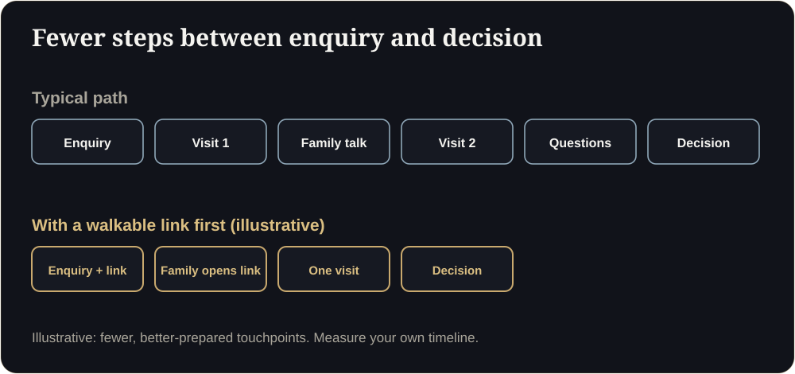

**Key takeaways**

- A physical sample flat is valuable for material feel, but it costs fit-out, space, staff and upkeep, and only serves people who can visit.
- With roughly 20 to 35% of Indian site visits converting to bookings, every poorly prepared visit is expensive.
- A digital sample flat pre-qualifies visitors and reaches those who cannot travel. It does not replace touching the finishes.
- The best setup is a hybrid: digital first, physical to close.

The wasted SaturdayA couple drives 90 minutes to your sales gallery on a Saturday. They stay 20 minutes, realise the bedroom is smaller than they hoped, and leave. You paid for the staff, the electricity and the coffee. A ten-minute walkthrough the night before would have told them, and you, the same thing for free.

## What a physical sample flat really costs

Most developers know the fit-out bill. Fewer add up everything else:

- **Fit-out and furnishing** (one-time), often rebuilt for each unit type.
- **Space:** rent, or the opportunity cost of land and floor area you could have sold.
- **Staff:** hosts, security, housekeeping and sales executives.
- **Upkeep:** electricity, cleaning, repairs, replacements.
- **Dismantling or conversion** at the end.
- **The hidden cost:** visits that go nowhere, and buyers who never come.

## Physical, digital or hybrid?

| | Physical sample flat | Digital sample flat | Hybrid |
|---|---|---|---|
| Reach | Visitors to one location | Anyone with a phone | Everyone, then the best prospects visit |
| Opening hours | Sales-office hours | 24/7 | 24/7 plus scheduled visits |
| Cost to change | High | Moderate | Moderate |
| Material feel | Excellent | Limited | Excellent where it counts |
| Pre-qualification | None | Strong | Strong |

## How a hybrid works in practice

1. **Digital first.** The first reply to every enquiry carries a walkthrough link.
2. **Ask a question.** "Which room matters most?" shows you what to emphasise.
3. **Book a visit with intent.** Buyers who understand the layout arrive with real questions.
4. **Use the physical flat to close:** finishes, fittings, the feel of materials.
5. **Follow up with the link** so the whole family can look again.

<figure class="fig"><figcaption>Fewer, better-prepared touchpoints (illustrative).</figcaption></figure>

## Where the physical flat still wins

- Buyers who want to touch and test fittings.
- Luxury segments where the sales gallery is part of the brand.
- Events and investor tours.

## The numbers to track

- Site visits per week and **cost per site visit**.
- Share of visits that convert to a booking.
- Share of visitors who opened the walkthrough beforehand.
- Staff hours spent per booking.

Published Indian benchmarks suggest roughly 8 to 15% of leads become site visits and 20 to 35% of visits become bookings, so improving visit quality moves revenue quickly. See our [friction guide]().

## Try the hybrid for 30 days

Should we close our sample flat?

Not necessarily. Many developers keep it for closing and use digital for first impressions. Decide with your own numbers.

Does digital work in Dubai too?

Yes. Many buyers are overseas, so a link often replaces a trip. Keep permit numbers visible.

## Sources

- [OwlClaw, real estate marketing benchmarks (India)](https://owlclaw.com/benchmarks/real-estate-marketing-benchmarks)
- [Sell.do, paid lead generation for Indian real estate (2026)](https://www.sell.do/blog/paid-lead-generation-real-estate-india-2026)

*Figures are as reported by the cited sources at the time of writing (November 2026). Check the latest releases before quoting them.*
