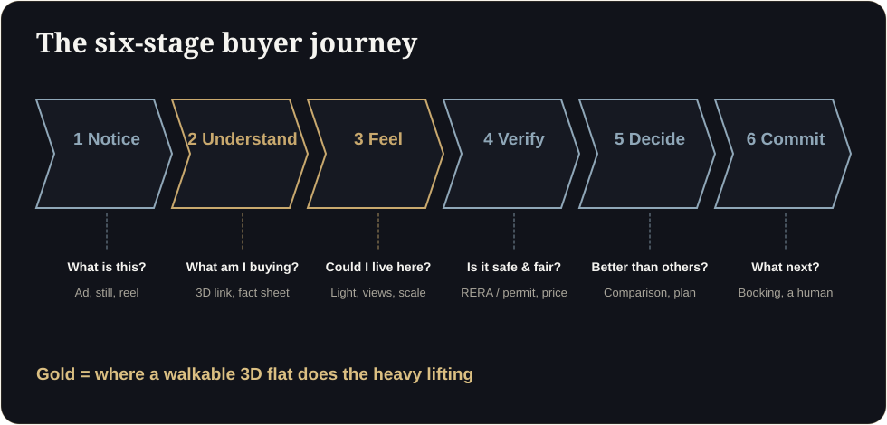

**Key takeaways**

- Clarity helps when buyers hesitate for lack of understanding. Test it instead of assuming it.
- Split enquiries into two groups: with and without the walkthrough link in the first reply. Track visits and bookings for 30 days.
- Measure speed to visit, visit quality and booking rate, not just lead count.
- Independent studies show tours help screening more than price. Read your own results the same way.

The sceptic's briefA sales head says, 'Everyone tells me 3D increases conversion. Prove it.' Fair. This is how: two groups of leads, one variable, thirty days, and a number at the end.

## Why test

Vendors, us included, will tell you clarity improves conversion. The evidence in published research is more careful: a UK study linked guided virtual viewings to higher conversion, while a Harvard Business School study of 75,000 sales found no significant price effect but better screening of unsuitable homes. Your project, city and buyer mix differ. A simple test tells you what applies to you.

## The test design

1. **Choose one project and one source** (for example, one portal or one ad set).
2. **Split enquiries** alternately: odd numbers get the walkthrough link in the first reply, even numbers do not.
3. **Keep everything else identical:** reply time, script, price, follow-up cadence.
4. **Run for 30 days** or until each group has at least 40 to 50 enquiries.
5. **Record** the metrics below in a shared sheet.

<figure class="fig"><figcaption>Clarity acts at the 'understand' and 'feel' stages.</figcaption></figure>

## Metrics that matter

| Metric | Why |
|---|---|
| Reply rate to the first message | Shows engagement |
| Time to site-visit booking | Speed of decision |
| Share who visit | Quality of interest |
| Visit-to-booking rate | Lead quality after the visit |
| Questions asked on the visit | Whether doubts were answered earlier |
| Discount requests | A proxy for uncertainty |

## Read the results honestly

- If both groups perform the same, clarity is not your bottleneck. Look at price, location or follow-up.
- If the link group visits more but books the same, visits are better prepared but something later is blocking: payment plan, approvals or trust.
- With small numbers, treat differences as signals, not proof.

## Score the clarity of your current assets

How long should the test run?

Thirty days is a practical minimum for most projects, or until each group has about 40 to 50 enquiries.

Can we run it across several projects?

Yes, but change one thing at a time. Start with a single project.

## Sources

- [twentyci virtual viewings research (via The Negotiator)](https://thenegotiator.co.uk/virtual-viewings-research-twentyci/)
- [Harvard Business School, Are Virtual Tours Still Worth It? (75,000 home sales)](https://www.library.hbs.edu/working-knowledge/are-virtual-tours-still-worth-it-in-real-estate-evidence-from-75000-home-sales)
- [OwlClaw, real estate marketing benchmarks (India)](https://owlclaw.com/benchmarks/real-estate-marketing-benchmarks)

*Figures are as reported by the cited sources at the time of writing (November 2026). Check the latest releases before quoting them.*
