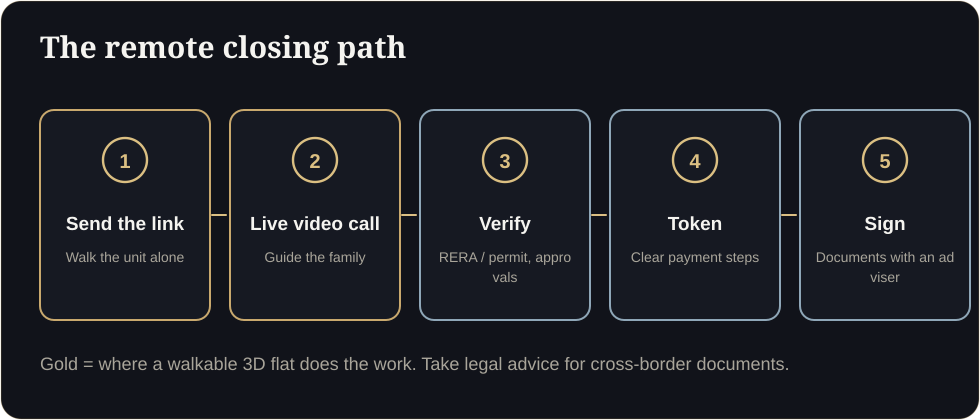
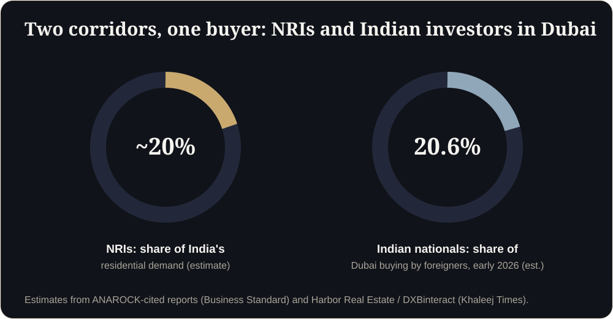

**Key takeaways**

- Remote closing is a process, not a link: show, guide, verify, pay and sign.
- A walkable 3D flat does the 'show' and 'guide' steps. Verification and documents need clear, compliant, human support.
- Indian nationals are among Dubai's top foreign buyers and NRIs are estimated at about a fifth of India's demand, so the corridor is large.
- Take legal advice for cross-border payment and documentation. Do not improvise.

Where remote deals stallA buyer in Singapore likes a flat in Pune. She is ready. But nobody has told her how to verify the project, how to pay the token from abroad or which documents to sign. She waits two weeks, and a competitor with a clearer process wins.

## The five steps

<figure class="fig"><figcaption>The remote closing path.</figcaption></figure>

### 1. Show: the walkthrough link
Send a link per unit type. Ask which rooms matter most.

### 2. Guide: a live walkthrough call
A trained salesperson opens the same link on a video call and walks the family through it. Family members in different countries see the same thing.

### 3. Verify: proof, in plain language
Registration details (RERA number and QR code in Maharashtra, advertising permit number in Dubai), approvals, developer track record, payment schedule and timelines, on one page.

### 4. Token: a clear payment path
Explain how to pay from abroad, what the receipt looks like and what the refund terms are. Keep it simple and transparent.

### 5. Sign: documents with an adviser
Agreements and cross-border rules vary. Offer a checklist and recommend independent legal advice.

<aside class="inline-cta" markdown="0">

Close deals across borders

Send one floor plan and get a link you can use on your next remote call.

<a class="cta" href="#get-demo" data-track="post_inline_cta" data-label="Get my free 3D demo">Get my free 3D demo</a><a class="btn-ghost" href="https://app.sandmotion.in/" target="_blank" rel="noopener" data-track="live_demo_click" data-label="inline">Try the live demo</a>

</aside>

## The numbers behind the opportunity

Estimates cited in the Indian press, based on ANAROCK research, put NRIs at roughly a fifth of India's residential investment, and Indian nationals were the top international group buying in Dubai in early 2026 (an estimated 20.6%). Treat these as estimates, but remote buyers are a real segment.

<figure class="fig"><figcaption>The India and Dubai corridor.</figcaption></figure>

## A remote-closing call agenda (30 minutes)

1. 3 min: who is on the call and what matters most.
2. 10 min: walk the unit together on the shared link.
3. 5 min: views, floors and availability.
4. 5 min: verification page and approvals.
5. 5 min: price, payment plan and next steps.
6. 2 min: recap by WhatsApp with the link.

Recap message after the callThank you for your time today. Here is the walkthrough link to share with your family: {link}. Summary of what we agreed: {unit}, {floor}, {price}, {payment_plan}. Verification page: {verify_link}. When would you like to take the next step?

## Remote-closing readiness

Is this legal or tax advice?

No. Foreign exchange, tax and documentation rules differ by country. Recommend independent professional advice.

Do remote buyers need Arabic or Hindi?

Offer the languages your buyers speak at home. A short voice-over or interface option goes a long way.

## Sources

- [NRI demand citing ANAROCK (Business Standard)](https://www.business-standard.com/markets/news/rupee-fall-boosts-nri-investments-in-luxury-and-ultra-luxury-properties-125030900443_1.html)
- [Indian investors in Dubai (Khaleej Times)](https://www.khaleejtimes.com/business/indian-uk-egyptian-investors-top-dubai-property-buyers-in-2026)
- [MahaRERA QR code order, mandatory from 1 August 2023 (Housing.com)](https://housing.com/news/qr-code-display-in-all-maharera-registered-projects-mandatory-from-aug-1-2023/)
- [Complete guide to the Trakheesi system in Dubai (Bayut)](https://www.bayut.com/mybayut/trakheesi/)

*Figures are as reported by the cited sources at the time of writing (November 2026). Check the latest releases before quoting them.*
