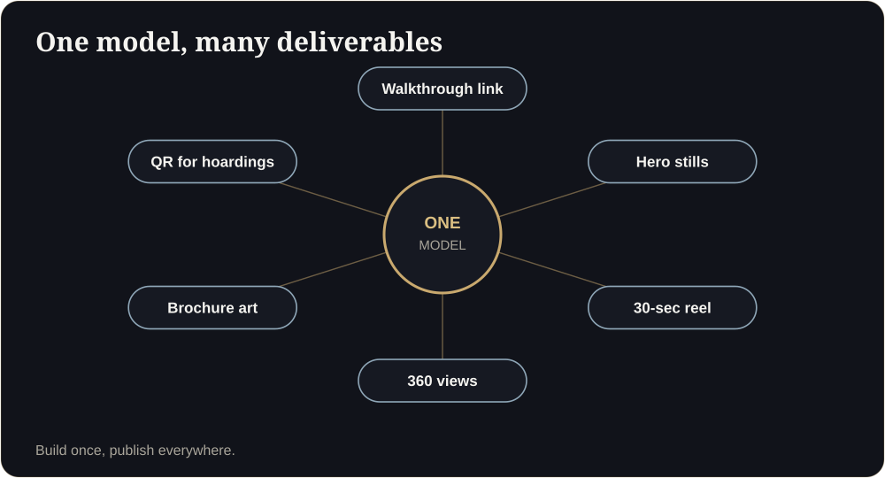

**Key takeaways**

- Institutional investors evaluate location, structure, track record and returns first. Visuals support the case, they do not replace the numbers.
- A good visual pack makes the project verifiable: accurate models, clear amenities, progress views and honest disclaimers.
- Dubai's selective market and India's high unsold stock mean investors compare many projects and reward clarity.
- Keep a single source of truth: one model, versioned, used across every deck.

Three decks, one analystA fund's analyst receives three decks. Two are 80-page PDFs of the same polished renders. The third opens a link: the same project, a walkable model, a progress view and a one-page fact sheet. She opens the third first.

## What investors actually look at

Institutional investors, funds and family offices look first at land, approvals, developer track record, pricing, absorption and returns. Visuals matter because they make the project understandable and verifiable quickly, especially when the audience is remote and time-poor.

## The visual due-diligence pack

| Item | What it shows | Why it helps |
|---|---|---|
| Walkable unit and amenity model | Layouts, proportions, quality | Understanding |
| Exterior and masterplan view | Massing, context, access | Credibility |
| Accurate area and unit-mix sheet | Numbers that match the model | Verification |
| Progress update view | Dated photos, model comparison | Transparency |
| Compliance page | Registration, approvals, permits | Trust |
| Disclaimers | Artist's impression wording | Honesty |

<figure class="fig"><figcaption>One accurate model feeds every item in the pack.</figcaption></figure>

## Market context investors will bring

In India, launches have outrun sales for 16 straight quarters in Knight Frank's top eight cities, and ANAROCK counts about 6.3 lakh unsold homes in its top seven. In Dubai, off-plan is still the largest segment (AED 41.58 billion in Q3 2026) but ready-home share is rising. Investors in both markets are comparing many projects. They reward whoever communicates a project clearly and credibly.

<aside class="inline-cta" markdown="0">

Present your project like an asset

Send one plan and we will show how a walkable model fits into your investor pack.

<a class="cta" href="#get-demo" data-track="post_inline_cta" data-label="Get my free 3D demo">Get my free 3D demo</a><a class="btn-ghost" href="https://app.sandmotion.in/" target="_blank" rel="noopener" data-track="live_demo_click" data-label="inline">Try the live demo</a>

</aside>

## Rules for investor-grade visuals

1. **Accuracy first.** Areas and unit mix must match the model and the registered plan.
2. **Version control.** Every asset carries a version and date.
3. **Honest labels.** Concept images are labelled as an artist's impression.
4. **Progress honesty.** Show real construction status next to the model.
5. **Privacy.** Use gated links and NDAs where needed.

Do investors care about 3D?

They care about clarity and verifiability. A good model helps them understand quickly, but financials, approvals and track record come first.

Can the same model serve buyers and investors?

Yes. Use one accurate model, and add the investor-specific pages (returns, progress, compliance) around it.

## Sources

- [Knight Frank India Q3 2026 (via Gulf Today)](https://www.gulftoday.ae/business/2026/10/24/indias-residential-market-holds-steady-in-third-quarter-of-2026)
- [ANAROCK Q3 2026 (via The Realty Today)](https://therealtytoday.com/news/news/q3-2026-housing-sales-rise-3-y-o-y-in-top-7-cities-new-launches-up-18/)
- [Dubai Land Department Q3 2026 (via Zawya)](https://www.zawya.com/en/press-release/research-studies/dubai-real-estate-transactions-reach-aed-90.62bln-in-q3-as-off-plan-remains-the-largest-residential-segment-1510107)
- [betterhomes Q3 2026 (via Khaleej Times)](https://www.khaleejtimes.com/business/property/dubai-ready-home-sales-jump-16-as-buyers-shift-away-from-off-plan-properties)

*Figures are as reported by the cited sources at the time of writing (November 2026). Check the latest releases before quoting them.*
