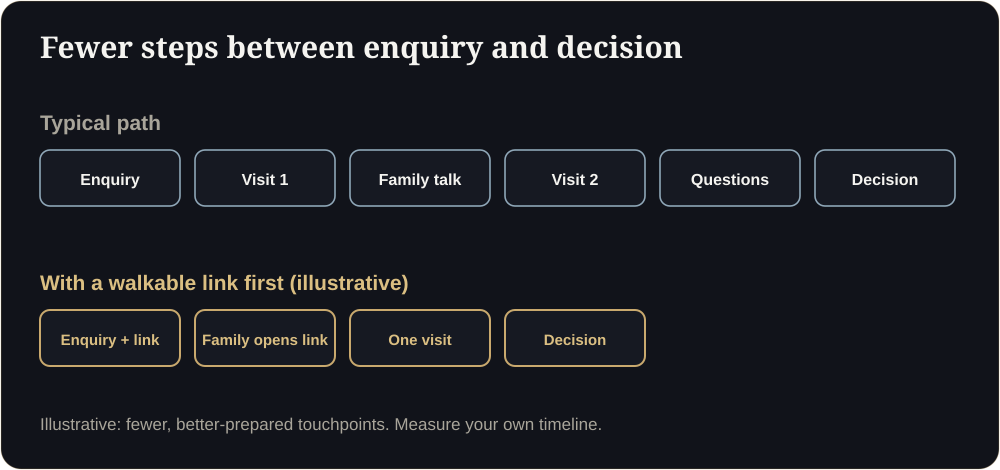

**Key takeaways**

- Most property deals are not lost, they drift. A cadence beats hope.
- Compress the path: link first, one prepared visit, a family share, a clear next step.
- Use a 14-day plan: day 0 link, day 1 check-in, day 3 family share, day 6 comparison, day 9 visit, day 12 close, day 14 respectful break-up.
- Measure days from enquiry to visit and to booking, and the number of touches.

How deals driftAn enquiry comes in on Monday. By Friday it has had one call and one brochure. By the following Friday the buyer has stopped replying. Nothing went wrong. Nothing went right either.

<figure class="fig"><figcaption>Fewer, better-prepared touchpoints (illustrative).</figcaption></figure>

## The 14-day plan

| Day | Action | Channel |
|---|---|---|
| 0 | Reply within 5 minutes with a walkthrough link and one question | WhatsApp |
| 1 | Check-in: "Did you get a chance to look inside?" | WhatsApp |
| 3 | Offer a family share: "Send this to your family so everyone sees the same thing" | WhatsApp |
| 6 | Send a comparison: price per carpet area, floors, views | WhatsApp or email |
| 9 | Book a prepared site visit or a live walkthrough call | Call |
| 12 | Clear next step: unit hold, token, documents | Call |
| 14 | Respectful close: "I will stop here, the link stays live" | WhatsApp |

Day 3 messageHi {name}, many families find it helpful to walk through the flat together. You can forward this link to anyone: {link}. Which floor and facing would you like me to check for you?

<aside class="inline-cta" markdown="0">

Give every enquiry something to open

We build the link you drop into your first reply and your day-3 family share.

<a class="cta" href="#get-demo" data-track="post_inline_cta" data-label="Get my free 3D demo">Get my free 3D demo</a><a class="btn-ghost" href="https://app.sandmotion.in/" target="_blank" rel="noopener" data-track="live_demo_click" data-label="inline">Try the live demo</a>

</aside>

## Speed metrics

- Median minutes to first reply.
- Days from enquiry to site visit.
- Days from enquiry to booking.
- Touches per booking.
- Share of enquiries that open the link.

See our guide to [pre-launch planning]() for the wider launch calendar.

Is following up for 14 days too much?

Not if each message adds value (a link, a comparison, an answer). Stop at day 14 respectfully.

What if the buyer replies late?

Keep the link live. Many buyers return weeks later when circumstances change.

## Sources

- [OwlClaw, real estate marketing benchmarks (India)](https://owlclaw.com/benchmarks/real-estate-marketing-benchmarks)
- [Sell.do, paid lead generation for Indian real estate (2026)](https://www.sell.do/blog/paid-lead-generation-real-estate-india-2026)

*Figures are as reported by the cited sources at the time of writing (November 2026). Check the latest releases before quoting them.*
