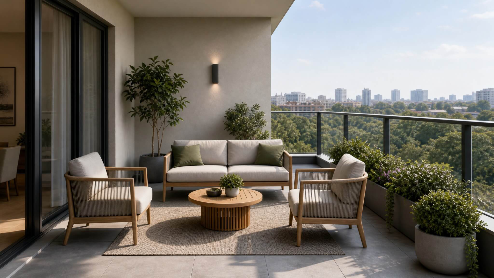

**Key takeaways**

- A digital sample flat is a true-to-scale, furnished 3D flat that buyers walk through in a browser, from one link, on any phone.
- Process: floor plan in, 3D model, light and materials, quality check, link out. Typically days for one unit type.
- It works around the clock, reaches remote buyers and updates quickly. It does not replace the feel of real materials.
- Costs depend on unit types, fidelity, views and hosting. Published ranges are in our cost guide.

Open 24/7It is 11:40 pm. A buyer in Dubai opens a link on his phone, walks through a 2BHK in Pune, looks at the balcony view and forwards the link to his brother. The sales office is closed. The flat was open all night.

## The definition

A **digital sample flat** is an interactive 3D replica of a unit (or several) that a buyer explores in a web browser. Unlike a brochure it can be walked through, unlike a video the buyer chooses where to look, and unlike a physical flat it exists everywhere there is a phone.

## What is inside one

- A **true-to-scale model** built from the approved plan.
- **Furniture and finishes** at realistic scale, often in two or three options.
- **Light and views:** a sun slider and window views for the real floor and facing.
- **Controls** that work on touch screens.
- **A next step:** a WhatsApp button, a share button and your compliance details.

<figure class="fig"><figcaption>How a floor plan becomes a digital sample flat.</figcaption></figure>

## How it is made (5 steps)

1. **Collect** the approved plan (DWG, DXF, PDF or JPG) and finish choices.
2. **Model** walls, openings, ceilings and fixtures to the plan's dimensions.
3. **Furnish and finish** with realistic materials and lighting.
4. **Optimise** for mobile: compress geometry and textures, bake lighting.
5. **Test and deliver** on low-, mid- and high-end phones, then publish one link.

For a single unit type this is measured in days. Larger projects are scheduled with you. See our [speed guide]() and [quality checklist]().

## Digital, physical or both?

## What it costs

Prices depend on the number of unit types, fidelity, views and hosting. Our [cost guide]() lists published ranges for India, Dubai and worldwide. We quote per project, and the first floor (up to 1,500 sq ft) is free.

<figure class="fig shot"><figcaption>A real screenshot from a Sandmotion walkthrough running in a browser.</figcaption></figure>

Is a digital sample flat the same as a video?

No. A video follows a fixed path. A digital sample flat lets the buyer walk anywhere, see light at different times and open it on any phone.

Do buyers need an app?

No. It opens in the browser from a link.

What do I need to start?

One approved floor plan and a short list of finishes.

## Sources

- [twentyci virtual viewings research (via The Negotiator)](https://thenegotiator.co.uk/virtual-viewings-research-twentyci/)
- [Harvard Business School, Are Virtual Tours Still Worth It? (75,000 home sales)](https://www.library.hbs.edu/working-knowledge/are-virtual-tours-still-worth-it-in-real-estate-evidence-from-75000-home-sales)
- [Google, Core Web Vitals thresholds (web.dev)](https://web.dev/articles/vitals)

*Figures are as reported by the cited sources at the time of writing (November 2026). Check the latest releases before quoting them.*
