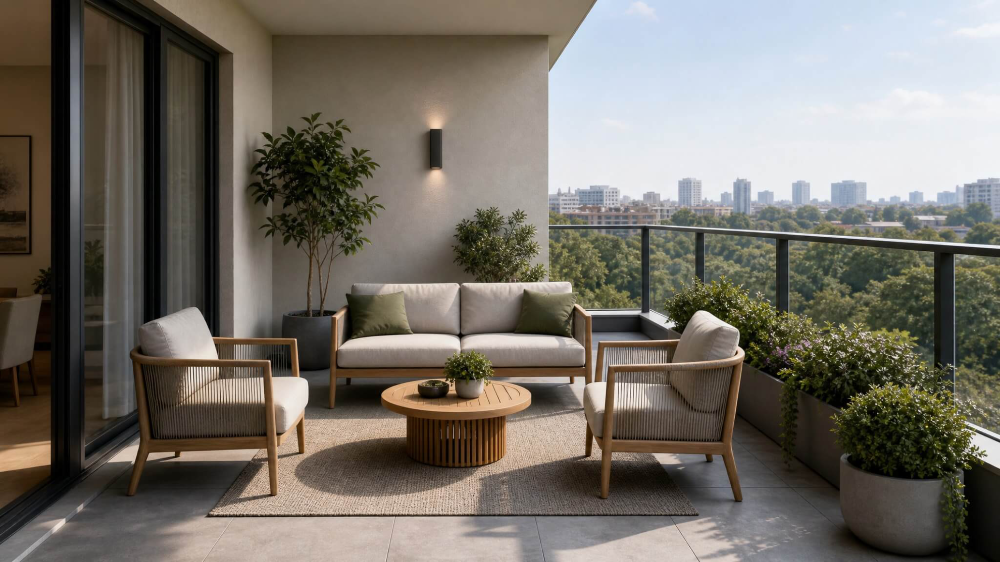

**Key takeaways**

- Buyers compare lifestyles after they compare prices. Showing a day in the home gives them something to feel and to share.
- Use real elements: morning light, the balcony at dusk, the walk to the kitchen, amenities in use.
- Keep it honest: do not show features that will not be delivered.
- Independent research does not promise price premiums, so measure engagement and enquiries instead.

Same price, different feelingTwo projects, same price per square foot. One shows a plan and a table of areas. The other lets you stand in the living room at 7 am as light crosses the floor, then walk to the balcony. Which one do you tell your sister about?

## Why lifestyle sells

Carpet area and bedroom count are necessary, but they are the same on every flyer. Lifestyle is how buyers tell similar projects apart: morning light, a quiet study corner, a balcony that fits two chairs, a kids' play area within sight of the kitchen.

## Five lifestyle moments to show

1. **Morning:** light in the kitchen and living room.
2. **Work:** a corner for a desk, and how quiet it is.
3. **Evening:** the balcony and the view at dusk.
4. **Family:** how rooms connect and where children play.
5. **Weekend:** amenities (pool, gym, garden) in use, at human scale.

## Make it real, not decorative

- Show **actual views** from the actual floor.
- Add **scale cues** (people, furniture, plants) that are the right size.
- Use **Indian and Dubai context**: modular kitchen, utility balcony and pooja space in India; majlis, maid's room or sea view in Dubai.
- Label concept imagery as an artist's impression, and keep RERA and permit details visible.

<figure class="fig shot"><figcaption>A real screenshot from a Sandmotion walkthrough running in a browser.</figcaption></figure>

## A lifestyle storyboard template

Fill in for each unit typeMorning: {what the buyer sees at 7 am}. Work: {desk location}. Evening: {balcony view at 6 pm}. Family: {how rooms connect}. Weekend: {amenity}. Proof: {registration number / permit number}.

## What to measure

Do not promise a premium price. Track how long buyers spend in the walkthrough, which rooms they visit, how many share the link and how enquiries change after launch. If you want to see if lifestyle content helps with pricing power, read [Confidence and Pricing Power]().

Does lifestyle content justify higher prices?

The independent evidence on virtual tours and price is mixed. Use lifestyle content to win attention and trust, and test whether it changes your pricing power on your project.

## Sources

- [Harvard Business School, Are Virtual Tours Still Worth It? (75,000 home sales)](https://www.library.hbs.edu/working-knowledge/are-virtual-tours-still-worth-it-in-real-estate-evidence-from-75000-home-sales)
- [twentyci virtual viewings research (via The Negotiator)](https://thenegotiator.co.uk/virtual-viewings-research-twentyci/)
- [MahaRERA QR code order, mandatory from 1 August 2023 (Housing.com)](https://housing.com/news/qr-code-display-in-all-maharera-registered-projects-mandatory-from-aug-1-2023/)
- [Complete guide to the Trakheesi system in Dubai (Bayut)](https://www.bayut.com/mybayut/trakheesi/)

*Figures are as reported by the cited sources at the time of writing (November 2026). Check the latest releases before quoting them.*
