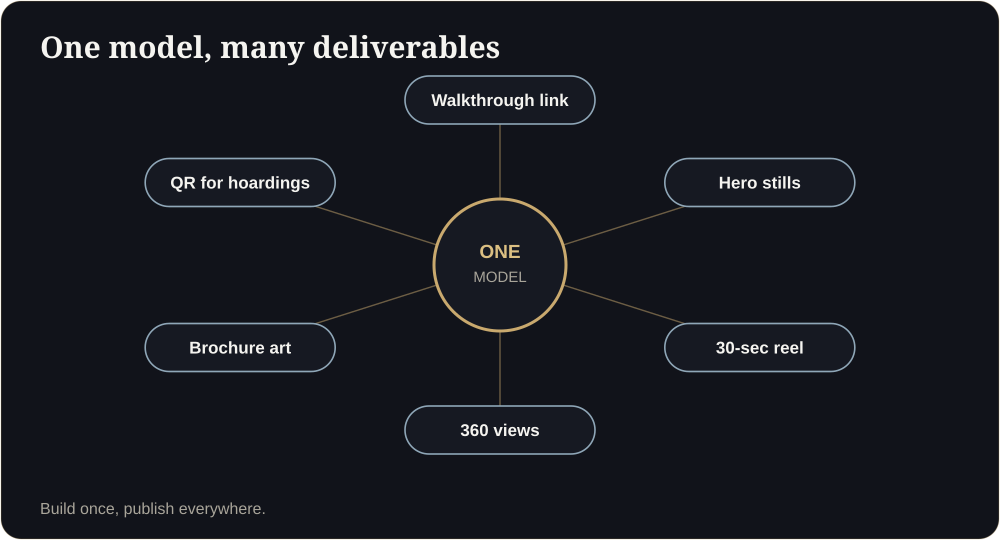

**Key takeaways**

- Every asset has a job: get attention, create understanding, give proof or ask for a decision. Many do none of these.
- Audit your assets against the question 'what decision does this help the buyer make?'
- Tag every link and measure which assets lead to enquiries and visits, not only views.
- One accurate model can produce stills, reels, a walkthrough and brochure art, so the stack stays consistent.

Forty assets, zero dataA developer proudly lists 40 marketing assets: renders, a film, hoardings, brochures, drone footage. Asked which ones bring site visits, the team goes quiet. Nobody has tagged the links.

## The question

> What decision does this asset help the buyer make?

If the honest answer is 'none, it looks nice', the asset belongs in the brand budget, not the sales budget.

## Four jobs for visuals

| Job | Asset | Metric |
|---|---|---|
| Attention | Hero stills, reel, hoardings | Reach, click-through |
| Understanding | Walkthrough link, floor plan | Link opens, time spent |
| Proof | Fact sheet, approvals page | Questions answered |
| Decision | Comparison, payment plan, booking path | Visits and bookings |

<figure class="fig"><figcaption>One accurate model feeds every job.</figcaption></figure>

## Audit your stack

## Tag everything

Add a campaign tag (UTM) to every link you publish: hoardings (QR), ads, WhatsApp scripts, broker links. Then review weekly which assets lead to enquiries and visits. Our [link-tracking guide]() shows how.

<aside class="inline-cta" markdown="0">

Turn visuals into sales assets

Send one plan and we will show a walkthrough, stills and a reel built from one model.

<a class="cta" href="#get-demo" data-track="post_inline_cta" data-label="Get my free 3D demo">Get my free 3D demo</a><a class="btn-ghost" href="https://app.sandmotion.in/" target="_blank" rel="noopener" data-track="live_demo_click" data-label="inline">Try the live demo</a>

</aside>

## Build from one model

Produce the walkthrough, hero stills, a short reel, 360 views, brochure art and QR codes from the same accurate model. It saves money and keeps every asset consistent. See [the technology comparison]().

## Review monthly

Should we stop making beautiful renders?

No. Attention is a real job. Just do not expect a render to do the work of understanding or proof.

## Sources

- [OwlClaw, real estate marketing benchmarks (India)](https://owlclaw.com/benchmarks/real-estate-marketing-benchmarks)

*Figures are as reported by the cited sources at the time of writing (November 2026). Check the latest releases before quoting them.*
