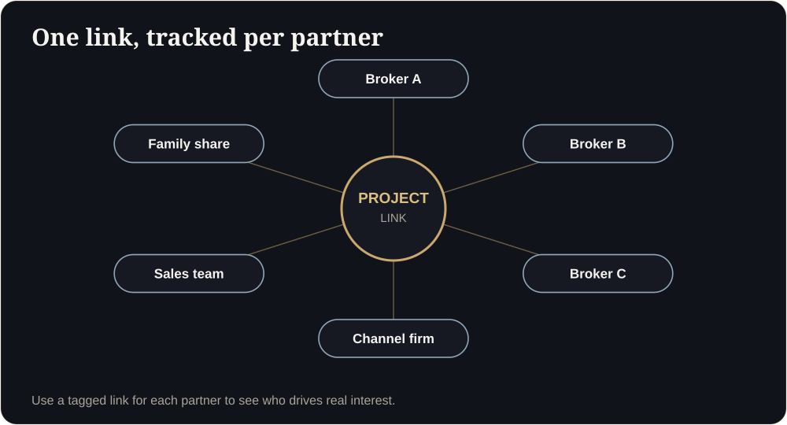

**Key takeaways**

- One link can serve thousands of viewers at once if the walkthrough runs on the viewer's device.
- Make every link shareable: clean URL, WhatsApp preview image, short title.
- Tag every link per channel and per partner so you know what works.
- Track opens, time spent and shares, then act on warm leads quickly.

One forward, three callsA broker shares your link in a WhatsApp group of 200 people. By the next morning there are 90 opens, 14 forwards and three calls. If the link was untagged, you will never know which broker did it. If it was tagged, you will send her a thank-you and the next project.

## Why one link scales

When a walkthrough runs in the viewer's browser, each additional viewer uses their own device, so traffic does not require a server per person. That is what makes it practical to send the same link to a broker group, an NRI community and an ad audience at once. See our [technology comparison]().

## Link hygiene

- **Clean and short:** a domain you own, a readable path.
- **One link per unit type**, not one giant link for the project.
- **A WhatsApp preview** with a real room image and a clear title.
- **No login or pop-up** before the buyer sees anything.
- **A visible next step:** WhatsApp button and share button.

<figure class="fig"><figcaption>Tag each link so you know who drives real interest.</figcaption></figure>

## Tag every share

Add campaign parameters (UTM) per channel and partner, for example: `?utm_source=broker_ritu&utm_medium=whatsapp&utm_campaign=tower_a_2bhk`. Then you can answer: which partner, which channel and which unit type bring opens and calls?

<aside class="inline-cta" markdown="0">

Get a link built to be shared

Send one plan and we will set up a shareable, trackable link for your next launch.

<a class="cta" href="#get-demo" data-track="post_inline_cta" data-label="Get my free 3D demo">Get my free 3D demo</a><a class="btn-ghost" href="https://app.sandmotion.in/" target="_blank" rel="noopener" data-track="live_demo_click" data-label="inline">Try the live demo</a>

</aside>

## The metrics to watch

| Metric | What it tells you |
|---|---|
| Link opens | Reach |
| Unique viewers | Real interest |
| Time spent and rooms viewed | Depth of interest |
| Shares and forwards | Family and partner involvement |
| Calls and WhatsApp clicks from the link | Intent |

## Act on warm leads fast

Set a rule: if a viewer opens the walkthrough for more than five minutes or clicks WhatsApp, someone calls within the hour. Speed matters: see our [friction guide]().

Can one link really serve thousands of people?

Yes, when the experience runs on the viewer's device. Pixel-streamed experiences need server capacity per viewer.

Should the link be public?

For marketing, yes. For investors or unreleased projects, use gated links and NDAs.

## Sources

- [OwlClaw, real estate marketing benchmarks (India)](https://owlclaw.com/benchmarks/real-estate-marketing-benchmarks)

*Figures are as reported by the cited sources at the time of writing (November 2026). Check the latest releases before quoting them.*
