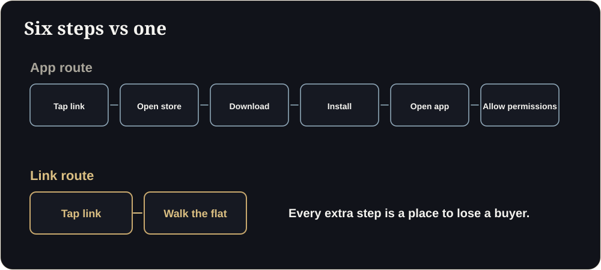

**Key takeaways**

- Luxury is an effortless experience. Every sign-up wall, slow load or confusing control reads as a lack of care.
- Audit ten points across speed, access, clarity, brand, compliance and follow-up.
- Google's good thresholds (LCP 2.5 s, INP 200 ms, CLS 0.1) are a useful starting benchmark for the web part.
- Fix the first three friction points you find. Then re-audit.

The pop-up problemA buyer clicks your ₹12 crore penthouse link from a WhatsApp message. A cookie banner, a newsletter pop-up and a 'create account' screen appear before she sees a single room. She closes it. Not because it was bad, but because it was effortful.

## Luxury is the absence of effort

Premium buyers are used to being served, not asked to work. The digital experience of your project is a preview of how you will treat them later. Our earlier piece on [clarity as luxury]() covers the philosophy. This is the practical audit.

## The 10-point friction audit

## Complex vs effortless

| Complex | Effortless |
|---|---|
| Download an app | Tap a link |
| Create an account | Look around first, share details later |
| Wait for a loading bar | Poster image, then progressive load |
| Instructions screen | Self-explanatory controls |
| Generic contact form | WhatsApp button and a named person |
| Pop-ups | One clear action |

<figure class="fig"><figcaption>Every extra step is a place to lose a buyer.</figcaption></figure>

<aside class="inline-cta" markdown="0">

Give luxury buyers an effortless preview

Open the live demo on your phone, then send us one plan for your own project.

<a class="cta" href="#get-demo" data-track="post_inline_cta" data-label="Get my free 3D demo">Get my free 3D demo</a><a class="btn-ghost" href="https://app.sandmotion.in/" target="_blank" rel="noopener" data-track="live_demo_click" data-label="inline">Try the live demo</a>

</aside>

## The web basics

For the web part of your experience, Google's Core Web Vitals give useful benchmarks: a Largest Contentful Paint of 2.5 seconds or less, an Interaction to Next Paint of 200 milliseconds or less and a Cumulative Layout Shift of 0.1 or less are considered good. Heavy 3D needs deliberate engineering to approach them: see our [mobile speed guide]().

## How to run the audit

1. Ask three people who have never seen the link to open it on their phones while you watch.
2. Note every hesitation, pause or question.
3. Score the ten points above.
4. Fix the three worst items.
5. Repeat in a month.

Does luxury need cinematic effects?

Quality matters, but effects should never slow or confuse. A fast, clear, beautiful experience beats a spectacular but slow one.

## Sources

- [Google, Core Web Vitals thresholds (web.dev)](https://web.dev/articles/vitals)

*Figures are as reported by the cited sources at the time of writing (November 2026). Check the latest releases before quoting them.*
