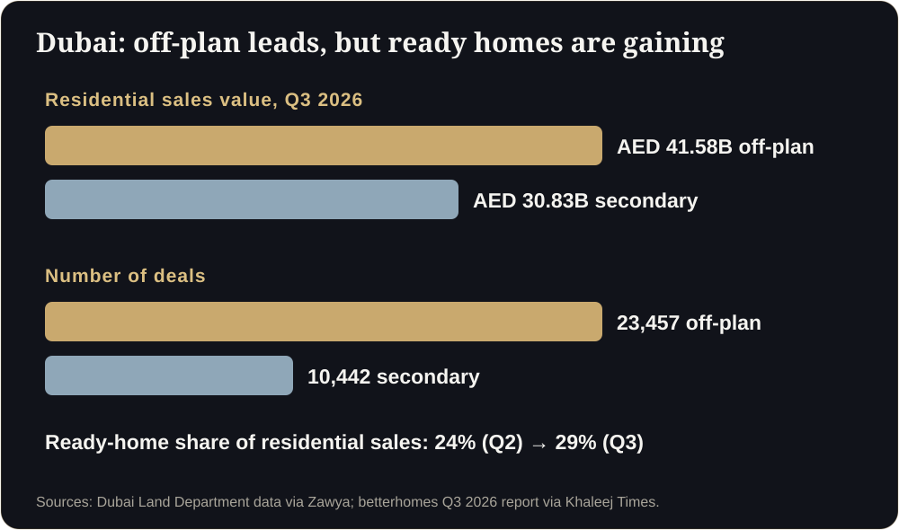

**Key takeaways**

- Uncertain buyers negotiate harder. Clearer projects can reduce discount pressure, but you must measure it.
- Independent research does not support a blanket price premium from virtual tours, so claim speed and fewer concessions, not higher prices.
- Dubai data shows few off-plan projects cut prices (44 of 717 by 5% or more) and that projects priced near the market absorbed faster.
- Track discount requests, concessions granted and days to booking before and after clarity improvements.

Same price, different conversationA buyer asks for 8% off. Not because the price is wrong, but because she cannot tell whether the flat is worth it. Another buyer, who has walked through the unit and checked the verification page, asks about the payment plan instead. Same price. Different conversation.

## Confidence is not a slogan, it is a measurable variable

When buyers cannot understand or verify a project, they protect themselves by negotiating, delaying and comparing endlessly. When they understand and trust it, those behaviours soften. That is a plausible mechanism. It still needs testing in your project.

## What the evidence says

A Harvard Business School study of more than 75,000 home sales found virtual tours had no significant effect on final price once photo quality and listing details were controlled for, though they helped buyers screen out unsuitable homes. A UK study reported a price uplift in a trial of guided viewings. The honest conclusion: do not promise higher prices. Measure whether clarity reduces concessions and speeds booking.

## What Dubai's data suggests

fäm Properties found that only 44 of 717 off-plan projects had cut prices by 5% or more since February, and that projects priced closer to market had higher absorption. Developers are mostly holding prices. In that setting, clarity and trust help you hold price while competitors discount.

<figure class="fig"><figcaption>Dubai, Q3 2026: off-plan is dominant, ready homes are gaining share.</figcaption></figure>

<aside class="inline-cta" markdown="0">

Protect your margins with clarity

Send one floor plan and see how a walkable, verifiable experience changes the conversation.

<a class="cta" href="#get-demo" data-track="post_inline_cta" data-label="Get my free 3D demo">Get my free 3D demo</a><a class="btn-ghost" href="https://app.sandmotion.in/" target="_blank" rel="noopener" data-track="live_demo_click" data-label="inline">Try the live demo</a>

</aside>

## Measure pricing power

| Metric | How to track |
|---|---|
| Discount requests per 100 enquiries | Log in the CRM |
| Average concession granted | Finance sheet |
| Days from enquiry to booking | CRM timestamps |
| Share of bookings at list price | Sales records |
| Buyer questions on value vs price | Sales notes |

Record a baseline for the previous 60 days. After launching clearer assets, track the same numbers for 60 days. Compare, and be honest about other changes (festive offers, price revisions).

## Build confidence deliberately

1. **Understanding:** a walkable flat, views and sun.
2. **Verification:** registration, approvals, permits, payment plan.
3. **Consistency:** the same facts everywhere, signed off.
4. **Speed:** replies in minutes. See [our friction guide]().
5. **Honesty:** artist's impression labels and no over-promising.

Will clarity let me raise prices?

Not reliably. Evidence on price is mixed. The more defensible goal is fewer concessions and faster bookings.

Should I stop offering discounts?

That is a commercial decision. Use data on concessions and absorption to decide.

## Sources

- [Harvard Business School, Are Virtual Tours Still Worth It? (75,000 home sales)](https://www.library.hbs.edu/working-knowledge/are-virtual-tours-still-worth-it-in-real-estate-evidence-from-75000-home-sales)
- [twentyci virtual viewings research (via The Negotiator)](https://thenegotiator.co.uk/virtual-viewings-research-twentyci/)
- [fäm Properties off-plan analysis (via Khaleej Times)](https://www.khaleejtimes.com/dubai-developers-hold-off-plan-pricing-as-only-6-projects-cut-prices-by-5-or-more-since-february)
- [Dubai Land Department Q3 2026 (via Zawya)](https://www.zawya.com/en/press-release/research-studies/dubai-real-estate-transactions-reach-aed-90.62bln-in-q3-as-off-plan-remains-the-largest-residential-segment-1510107)

*Figures are as reported by the cited sources at the time of writing (November 2026). Check the latest releases before quoting them.*
