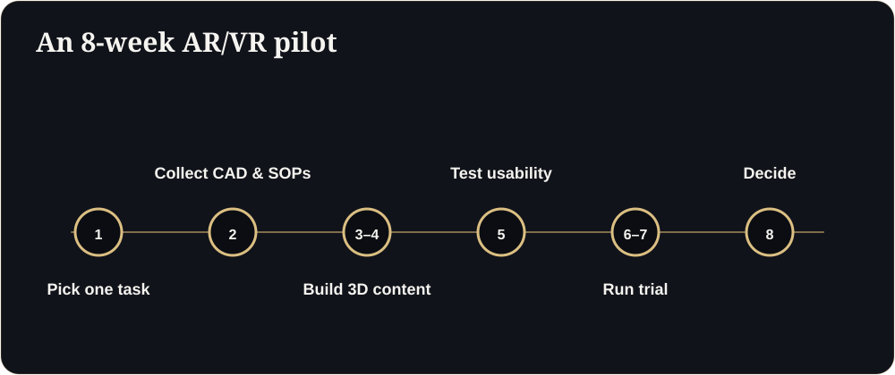

**Key takeaways**

- Controlled studies and reviews show AR guidance can reduce task time and errors in assembly and maintenance compared with paper or screen instructions.
- Evidence for AR and VR safety training is positive overall, but at least one meta-analysis found no significant difference in knowledge acquisition: measure what you care about.
- Pick one high-value task, pilot for about eight weeks, and compare against your current method.
- Tablets and phones can deliver AR for many tasks before you invest in headsets.

Practice without the riskA new technician has to learn a start-up sequence on a machine that costs more than his entire team's annual salary. Nobody wants him practising on the real thing. A safe, guided 3D version lets him rehearse as often as he likes, and the trainer sees where he hesitates.

AR and VR have had plenty of hype in industry. The useful question is not "is it exciting?" but "does it make a specific task faster, safer or cheaper than what we do now?"

## What the research suggests

A 2026 review of industrial augmented reality in manufacturing notes that AR has moved from lab demonstrations to operational pilots across design, training, assembly, maintenance and quality assurance. It reports that the strongest evidence is in assembly and maintenance, where AR guidance reduces task time and error rates compared with paper or screen-based instructions in multiple controlled studies and reviews. For AR safety training, a meta-analysis found a significant positive effect overall, but no statistically significant difference in knowledge acquisition.

It also stresses that moving from demo to dependable deployment requires attention to integration, safety, comfort and maintenance of the content, not only to the headset.

In short: there is real evidence of value for guided tasks, and real caveats for everything else.

## Three practical use cases

1. **Spatial maintenance and assembly guides.** Step-by-step 3D instructions anchored to the machine, on a tablet or smart glasses.
2. **VR training simulators.** Safe practice for hazardous or expensive equipment: hot work, high voltage, confined spaces, complex start-up sequences.
3. **AR overlays for inspection.** Technicians overlay the digital model on the physical machine to compare against the design or see hidden components.

## Choose where it will pay back

Look for tasks that are:

- **Frequent or high-risk,** so the benefit repeats.
- **Complex,** with many steps or a high cost of error.
- **Hard to train on the real equipment,** because it is costly, scarce or dangerous.
- **Stable in design,** so content does not go stale every month.

<aside class="inline-cta" markdown="0">

Pilot AR or VR on one real task

Share a CAD file and a task description. We will scope a feasibility assessment for training or field guidance.

<a class="cta" href="/industrial.html#assessment" data-track="post_inline_cta" data-label="Request a feasibility assessment">Request a feasibility assessment</a><a class="btn-ghost" href="https://app.sandmotion.in/" target="_blank" rel="noopener" data-track="live_demo_click" data-label="inline">Try the live demo</a>

</aside>

<figure class="fig"><figcaption>An 8-week pilot.</figcaption></figure>

## An 8-week pilot plan

| Week | Activity |
|---|---|
| 1 | Choose one task and write down how it is done and measured today: time, errors, incidents, trainer hours |
| 2 | Collect source models (CAD or BIM), procedures and safety rules |
| 3 to 4 | Build the 3D content and guided steps; review with engineers and operators |
| 5 | Test with a small group on a tablet or headset; fix usability problems |
| 6 to 7 | Run a trial with trainees or technicians; compare with the current method |
| 8 | Review results and decide: stop, adjust, or scale to another task |

## What to measure

- Time to complete the task
- Error or rework rate
- Time to competence for new staff
- Trainer hours saved
- Near-misses and incidents in training
- User feedback on comfort and clarity

## Start light

Not every task needs a headset. Phones and tablets can deliver browser-based 3D and basic AR with no special hardware. Reserve headsets for hands-free work or fully immersive training where they add something.

## Risks to plan for

- Content goes out of date when equipment changes.
- Integration with existing training or maintenance systems.
- Comfort, safety and hygiene in shared headsets.
- Data and IP security: use NDAs and clear storage rules.

## Next step

Choose one task, gather the CAD and procedure, and ask for a feasibility assessment. We will tell you what is realistic, what it would involve and how to measure it.

## Pick your pilot task

## Metrics to record before you start

Do we need headsets?

Not always. Many guided tasks work on tablets and phones. Use headsets where hands-free work or full immersion adds value.

## Sources

- [Industrial augmented reality review: benefits, risks and deployment (arXiv, 2026)](https://arxiv.org/pdf/2606.11112)
- [Dassault Systèmes and Nasscom, virtual twin adoption report (Outlook Business)](https://www.outlookbusiness.com/corporate/80-of-companies-have-less-than-7-of-tech-spend-allocated-to-virtual-twin-adoption-report)

*Figures are as reported by the sources above at the time of writing (October 2026). Check the latest releases before quoting them.*
