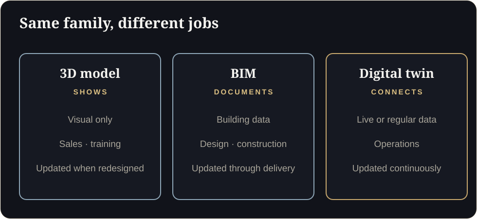

**Key takeaways**

- A 3D model shows what something looks like, BIM stores building information, and a digital twin stays connected to real operations. They solve different problems.
- Match the tool to the question: design review, training, facility management and live monitoring need different things.
- The most common mistake is buying a 'twin' with no data plan, or a data platform with nothing people can see.
- Plan in stages: visual first, data second, simulation third.

The model nobody opensA facility manager has a beautiful BIM model nobody opens, because the software costs a fortune and the people who need answers cannot read it. A browser view of that same model, with the pump rooms highlighted, would be used every day.

Vendors use "3D model", "BIM" and "digital twin" almost interchangeably. They are not the same, and buying the wrong one wastes budget.

## The differences in one table

| | 3D model | BIM (Building Information Model) | Digital twin |
|---|---|---|---|
| **What it is** | A visual representation of an object or space | A structured 3D model of a building with data attached to elements | A virtual replica linked to real-world data and operations |
| **Best at** | Showing, presenting, training | Designing, coordinating, documenting construction | Monitoring, analysing, simulating, optimising |
| **Data** | Mostly visual | Rich building data (materials, systems, quantities) | Live or regularly updated operational data |
| **Update frequency** | When redesigned | During design and construction | Continuously or periodically |
| **Typical users** | Sales, marketing, training, stakeholders | Architects, engineers, contractors | Operations, maintenance, engineering |

## Which one answers your question?

| You want to... | Start with |
|---|---|
| Present a building or plant to stakeholders | A real-time 3D model in the browser |
| Train new technicians on equipment | Interactive 3D, then AR or VR if the task justifies it |
| Coordinate design and construction | BIM |
| Manage a facility after handover | BIM data feeding a visual, searchable twin |
| Track machine status on a shop floor | A data-linked twin with a visual layer |
| Test layout or process changes | A simulation twin built on accurate models |

## Where real-time visualisation fits

Many organisations already have CAD or BIM models, but the models live in engineering software that most people cannot use. A real-time visual layer makes that investment usable for everyone: operators, managers, trainers and clients. It can then become the front end for data later.

## Common mistakes

1. **Buying a platform before knowing the question.** Dashboards without a clear decision to make go unused.
2. **Skipping the visual layer.** Data tables are hard for non-experts. People need to see where the problem is.
3. **Starting plant-wide.** Reports from Indian enterprises suggest many twin implementations take 12 to 24 months at each level, so a narrow start is wiser.
4. **Ignoring content upkeep.** A twin that does not follow design changes becomes misleading.
5. **Underestimating security.** Connected assets need clear access and data policies.

<aside class="inline-cta" markdown="0">

Which stage should you start with?

Share one CAD or BIM file and a short description of your goal. We will scope a feasibility assessment and recommend a first stage.

<a class="cta" href="/industrial.html#assessment" data-track="post_inline_cta" data-label="Request a feasibility assessment">Request a feasibility assessment</a><a class="btn-ghost" href="https://app.sandmotion.in/" target="_blank" rel="noopener" data-track="live_demo_click" data-label="inline">Try the live demo</a>

</aside>

<figure class="fig"><figcaption>Same family, different jobs.</figcaption></figure>

## A staged approach

1. **Stage 1: Visual twin.** One asset, line or floor in real-time 3D, used for design review, training and presentations.
2. **Stage 2: Data overlays.** Add status and key measurements where data already exists.
3. **Stage 3: Simulation and prediction.** Use the accurate model and data to test scenarios.

Each stage should earn its keep before the next begins.

## Questions to ask a vendor

- What do you need from us, and in which formats?
- How do you keep the model light enough for the browser?
- How will updates be handled when the design changes?
- What is delivered at each stage and what does it cost?
- Where is our data stored, and can you sign an NDA?

## The link to real estate

The same technology that lets a buyer walk through an unbuilt apartment lets an engineer walk through an unbuilt plant. If you have seen our real estate work, you have seen the foundation. For the technical comparison, see [WebGL vs Pixel Streaming vs Video vs 360]().

Share one CAD or BIM file and we will tell you which stage makes sense first.

## What should you buy first?

Can a BIM model become a digital twin?

It can be the foundation. A twin adds a live data connection and a purpose-built interface.

## Sources

- [Dassault Systèmes and Nasscom, virtual twin adoption report (Outlook Business)](https://www.outlookbusiness.com/corporate/80-of-companies-have-less-than-7-of-tech-spend-allocated-to-virtual-twin-adoption-report)
- [Dassault Systèmes and Nasscom, adoption timelines (CRN India)](https://www.crn.in/?p=65298)

*Figures are as reported by the sources above at the time of writing (October 2026). Check the latest releases before quoting them.*
