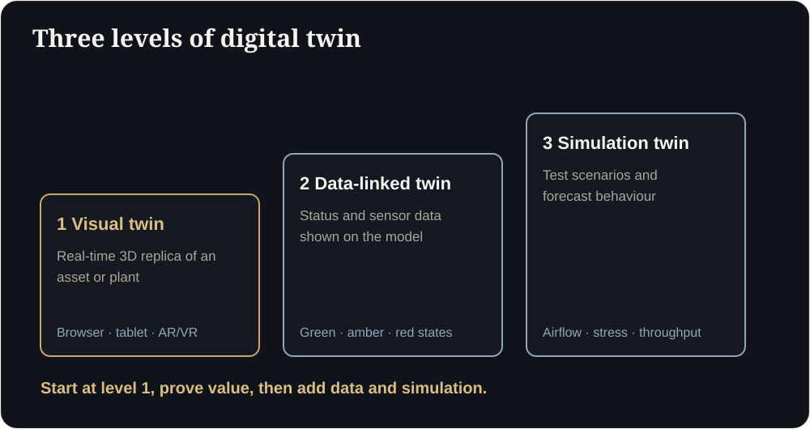

**Key takeaways**

- A digital twin is a virtual replica of an asset, plant or building that stays useful because it is connected to real information.
- Start with a visual twin of one asset or line, then add data overlays, then simulation. Most full implementations take 12 to 24 months per level.
- Reported benefits include reduced downtime and lower operating cost, but adoption is still cautious: most firms spend a small share of tech budget on twins.
- A short feasibility assessment on one real CAD or BIM file de-risks the project.

What a twin really isA plant manager asks for a 'digital twin'. The vendor sends a 40-page proposal on sensors and cloud platforms. What he actually needs first is simpler: a model his team can walk through on a tablet, with the three machines that cause trouble highlighted. That is a level 1 twin, and you can have it in weeks.

Digital twin is one of the most overused terms in industry, which makes it hard to know what you are actually buying. This guide explains how a twin works in practice, and how a CAD or BIM file becomes something your team can use.

## Three levels of digital twin

1. **Visual twin.** An accurate, real-time 3D replica of an asset, line or building that people can explore in a browser, on a tablet, or in AR and VR. This is the foundation.
2. **Data-linked twin.** The visual model is connected to status information: sensors, maintenance systems or dashboards. Parts change colour or animate to show state: steady green for nominal, pulsing amber for wear, flashing red for critical.
3. **Simulation or predictive twin.** The model is used to test scenarios and forecast behaviour: airflow, stress, throughput, failure.

Most organisations should start with level 1, prove value, and add levels as data and use cases mature.

<figure class="fig"><figcaption>Three levels of digital twin.</figcaption></figure>

## From CAD or BIM file to browser

1. **Collect the source.** SolidWorks, AutoCAD, Revit, BIM or other engineering models, plus drawings and a list of what matters.
2. **Clean and optimise.** Engineering models are far too heavy for real-time use. Remove hidden detail, simplify geometry and keep what people need to see.
3. **Apply materials and lighting.** Physically based materials make machinery and environments look right under different lighting.
4. **Build the environment.** A browser-based scene (WebGL), or an engine-based build in Unreal or Unity for high-fidelity settings.
5. **Add interaction.** Hover cards, exploded views, walk-through paths and status overlays.
6. **Deliver.** A link for any browser, an engine build for a control room, or AR and VR for field teams.

## What the adoption numbers say

A report by Dassault Systèmes and Nasscom, based on a survey of 130 companies in India, Europe and Asia-Pacific, found that about 80% of companies allocate less than 7% of technology spend to virtual twins, that implementations have roughly doubled since the pandemic, and that around 75% of implementations in India take 12 to 24 months at each level of product, process or system twin. A 2025 Manufacturing IT/OT Trend Report found more than 40% of manufacturing firms piloting digital twins, with almost two-thirds citing reduced downtime and operating costs.

The lesson is not that twins are a fad, but that they are a staged journey. Starting with one asset and a clear question is more realistic than a plant-wide programme.

<aside class="inline-cta" markdown="0">

See your own asset as a digital twin

Send a CAD or BIM sample and we will scope a feasibility assessment for the web, an engine or the field.

<a class="cta" href="/industrial.html#assessment" data-track="post_inline_cta" data-label="Request a feasibility assessment">Request a feasibility assessment</a><a class="btn-ghost" href="https://app.sandmotion.in/" target="_blank" rel="noopener" data-track="live_demo_click" data-label="inline">Try the live demo</a>

</aside>

<figure class="fig"><figcaption>CAD or BIM in, browser-ready 3D out.</figcaption></figure>

## Choose the right first project

A good first project has:

- **A clear question:** for example, "where are the bottlenecks on line 3?" or "how do we train new technicians on this machine faster?"
- **An accessible model:** CAD or BIM data exists and can be shared.
- **A visible audience:** operations, training, engineering or management who will actually use it.
- **A manageable scope:** one machine, one line, one building floor.

## What to prepare

- Source models and drawings
- A list of the components, areas and states that matter
- Any existing dashboards or data sources you may want to connect later
- Names of the people who will use the twin
- Security requirements, including NDA and data handling

## Where it applies

- **Manufacturing and Industry 4.0:** interactive plant floors, exploded machine views and shop-floor status.
- **Architecture and smart buildings:** BIM visualisers and building-system flow models.
- **Product design and engineering:** real-time 3D configurators and virtual commissioning.
- **Energy and utilities:** photorealistic virtual plants and safe spaces for training and inspection.

## Start with a feasibility assessment

The lowest-risk first step is a short assessment on one real file: what it would take to bring that specific asset to the browser, an engine or the field, and what you could expect. We scope assessments within 2 to 3 business days, and there is no obligation to proceed.

## Is your first project ready?

Do we need sensors to start?

No. A visual twin of one asset already helps with design review, training and presentations. Add data later.

Which file formats can you use?

Common CAD and BIM formats such as DWG, DXF, RVT, SKP and STEP. Send a sample and we will confirm.

## Sources

- [Dassault Systèmes and Nasscom, virtual twin adoption report (Outlook Business)](https://www.outlookbusiness.com/corporate/80-of-companies-have-less-than-7-of-tech-spend-allocated-to-virtual-twin-adoption-report)
- [Dassault Systèmes and Nasscom, adoption timelines (CRN India)](https://www.crn.in/?p=65298)
- [Manufacturing IT/OT Trend Report 2025 (Process Excellence Network)](https://www.processexcellencenetwork.com/tools-technologies/news/manufacturing-downtime-operational-costs-digital-twins/amp)

*Figures are as reported by the sources above at the time of writing (October 2026). Check the latest releases before quoting them.*
