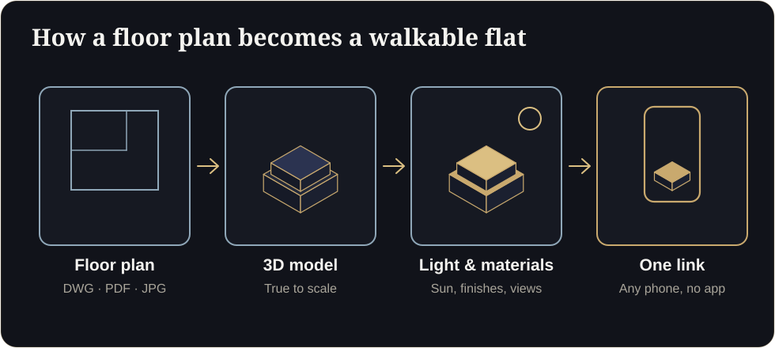

**Key takeaways**

- In Maharashtra, project promotions must carry the MahaRERA registration number and QR code (mandatory since 1 August 2023). MahaRERA has fined hundreds of projects for missing them.
- In Dubai, property adverts need a valid advertising permit (Trakheesi) and the permit number must appear on the advert.
- A 3D walkthrough link is advertising. Put the compliance details inside the viewer and next to every share.
- Label concept imagery, keep views and finishes honest, and ask your lawyer to review the wording.

Compliance is the most boring thing in marketing and the most expensive to ignore. This guide explains the rules developers and brokers commonly run into when they use 3D visuals, and gives you a checklist.

> This is general information, not legal advice. Rules change. Always confirm with your lawyer and the regulator.

<figure class="fig"><figcaption>Compliance details belong in the final link, not in a separate PDF.</figcaption></figure>

## India: MahaRERA and RERA basics

- **Registration number and QR code.** MahaRERA made it mandatory from 1 August 2023 to display the project's registration number and QR code on all advertisements and promotional material, and later fined 628 projects for non-compliance, according to reports. Fines of up to ₹50,000 have been reported.
- **Carpet area.** Under RERA, apartments are sold on carpet area. Keep area claims consistent with the registered plan.
- **Accuracy.** Do not show amenities, approvals or possession dates you cannot support.
- **Other states.** Each state has its own RERA authority and rules. Check yours.

## Dubai: Trakheesi and advertising

- **Advertising permit.** Property advertising in Dubai requires a valid permit through the Trakheesi system, and the permit number must appear on the advert. Abu Dhabi uses a different system (Madhmoun).
- **Who is responsible.** Developers and brokers each have obligations. Agree who supplies and checks the permit number.
- **Penalties.** Historic reports mention fines of up to AED 50,000. Check current schedules.

## Where 3D assets fit

A walkthrough link, a render in a social post, a broker's WhatsApp status: all are advertising. So:

1. Put the registration number, QR code or permit number **inside the viewer footer**.
2. Add them to the **landing page** and every **share preview**.
3. Include an **artist's impression disclaimer** where visuals are not final.
4. Keep a **version log** of what each asset showed and when.

Example disclaimer (have your lawyer review)Images and walkthroughs are an artist's impression and are for illustration only. Actual specifications, finishes and views may vary as per approved plans. RERA Registration No: {number}. Permit No: {permit}.

## Truthful visuals

- Views should reflect real site conditions.
- Furniture should be at scale and not imply it is included unless it is.
- Show approved neighbouring buildings only.
- AI-generated imagery must follow the same rules. See [AI in architectural visualization]().

## The compliance checklist

Does a 3D walkthrough replace the QR code?

No. Keep the QR code and registration details visible. The walkthrough adds clarity, not compliance.

Who is responsible for the permit number on a broker's post?

Both parties have obligations. Agree in writing who supplies, checks and updates the number.

Need a viewer that already has a place for your registration and permit numbers? Send us a plan and we will show you.

## Sources

- [MahaRERA QR code order, mandatory from 1 August 2023 (Housing.com)](https://housing.com/news/qr-code-display-in-all-maharera-registered-projects-mandatory-from-aug-1-2023/)
- [MahaRERA fines 628 projects for missing QR code and registration number (Housing.com)](https://housing.com/news/maharera-fines-628-projects-for-not-displaying-qr-code-registration-number/)
- [Complete guide to the Trakheesi system in Dubai (Bayut)](https://www.bayut.com/mybayut/trakheesi/)

*Figures are as reported by the cited sources at the time of writing (November 2026). Check the latest releases before quoting them.*
