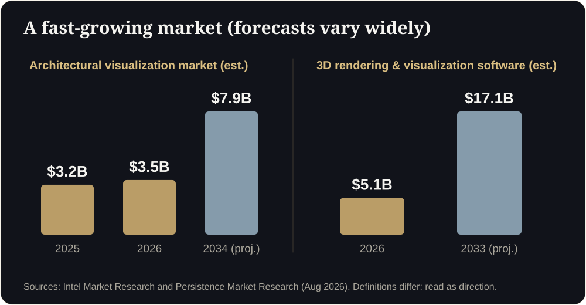
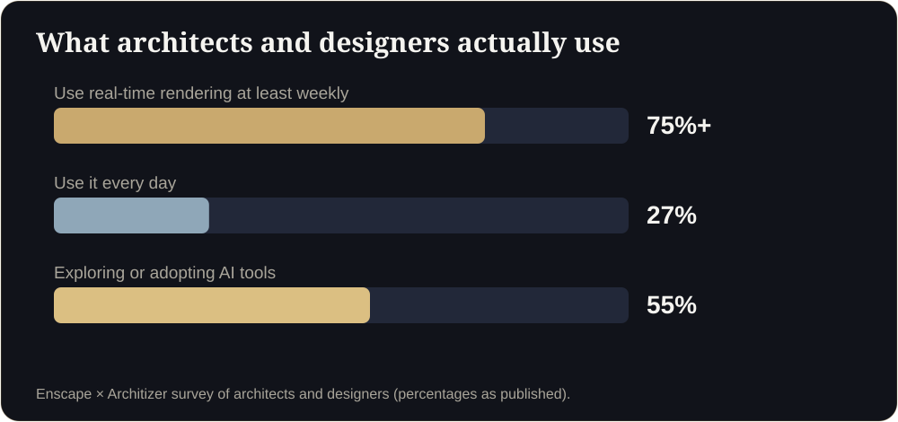
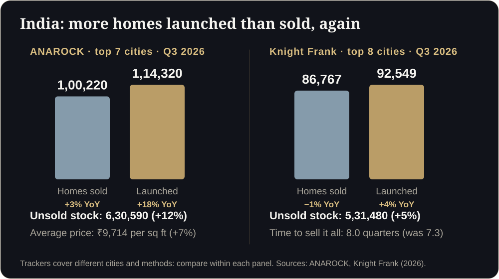
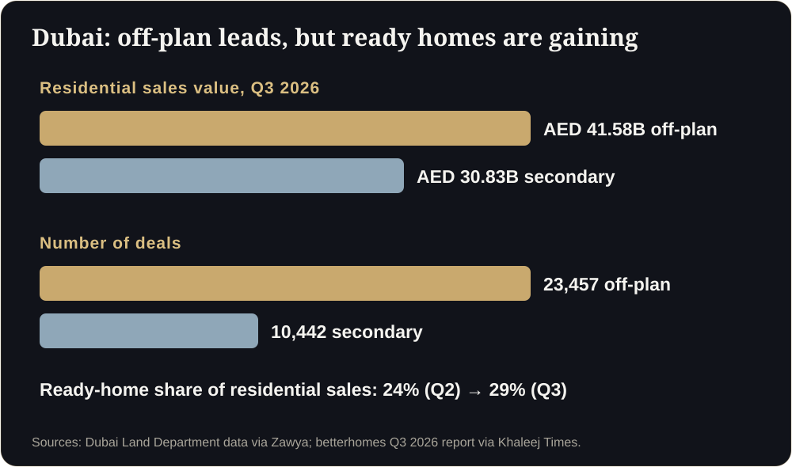
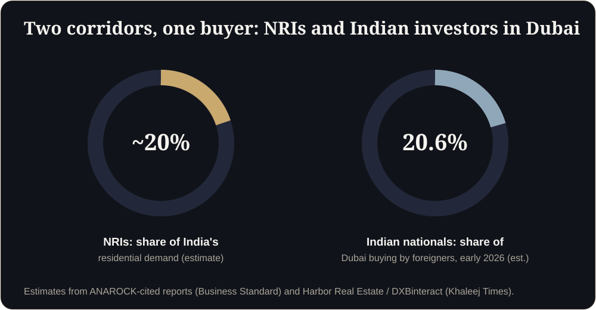

**Key takeaways**

- Analyst estimates put architectural visualization at roughly $3 to 4 billion today and the wider 3D rendering software market well above that, with forecasts of strong growth. Definitions vary, so read them as direction, not fact.
- In practice, real-time rendering is now mainstream: a published survey found more than 75% of architects and designers use it at least weekly, and more than half are exploring or adopting AI.
- India has more launches than sales and rising unsold stock (ANAROCK Q3 2026: 6.3 lakh homes). Dubai remains off-plan-led but more selective. Both reward whoever makes a project easiest to understand.
- Our view: the winners will deliver link-first, accurate, data-rich 3D, and use AI for speed rather than for facts.

Three years ago, an architectural visualization was a picture. In 2026 it is a link, a live model, a set of data and, increasingly, a sales channel. This report pulls together the numbers, the trends and what they mean for developers, architects and manufacturers in India, Dubai and worldwide.

<b>$3 to 4B</b>architectural visualization market, analyst estimates

<b>75%+</b>of architects use real-time rendering weekly

<b>55%</b>exploring or adopting AI tools

<b>16</b>quarters launches outran sales in India

## 1. How big is the market?

Different research houses measure different things, so the headline numbers disagree. Intel Market Research estimates the architectural visualization market at around $3.2 billion in 2025, growing to roughly $7.9 billion by 2034. Persistence Market Research sizes the wider 3D rendering and visualization software market at about $5.1 billion in 2026, rising to about $17.1 billion by 2033. These are analyst projections that rest on assumptions, and some come from reports sold behind paywalls.

<figure class="fig"><figcaption>Market estimates differ by definition. The direction is consistent: growth.</figcaption></figure>

What they agree on: demand is rising because real estate, architecture and engineering all need to communicate unbuilt things to people who cannot read drawings.

## 2. How professionals work now

A published Enscape and Architizer survey of architects and designers found that more than 75% use real-time rendering at least weekly, 27% use it every day, and 55% are exploring or adopting AI tools. Real-time engines (the same technology behind games) have moved from specialist teams into everyday design work.

<figure class="fig"><figcaption>What architects and designers actually use.</figcaption></figure>

## 3. Five shifts shaping 2027

These are our reading of the evidence, not forecasts from a single source.

1. **Real-time everywhere.** Game-engine and browser technology (WebGL today, WebGPU rising) lets a model run on the buyer's phone.
2. **Link-first delivery.** The unit of delivery is a link people forward on WhatsApp, not a file or an app. See our guide to [app-free walkthroughs]().
3. **AI for speed, geometry for commitment.** AI accelerates concepts, staging and drafts. Buyers still need dimensionally accurate models. See [AI in architectural visualization]().
4. **Data on top of visuals.** Which rooms were viewed, for how long, from which source: visuals become a sales signal.
5. **Visualization meets digital twins.** The same pipeline that sells a flat now trains technicians and monitors plants. See our [industrial digital twin guide]().

## 4. India: abundant supply, choosy buyers

ANAROCK's Q3 2026 data for the top seven cities shows 1,00,220 homes sold (up 3% year on year), 1,14,320 launched (up 18%) and about 6.3 lakh unsold (up 12%), with an average price of ₹9,714 per sq ft. Knight Frank's top eight cities show launches above sales for the 16th consecutive quarter and 8.0 quarters of inventory. MMR led sales with 31,750 homes in the ANAROCK data. Trackers use different city sets, so compare within each source.

<figure class="fig"><figcaption>India, Q3 2026: launches outran sales.</figcaption></figure>

**What it means.** When supply is high, buyers compare. Developers who show their product clearly and answer quickly win visits. Regulators add a compliance layer: in Maharashtra, project promotions must carry the MahaRERA registration number and QR code. Our [compliance guide]() covers both India and Dubai.

**Price anchors.** Published Indian studio guides in 2026 put a furnished 3D floor plan at roughly ₹6 to 12 per sq ft, interior renders at ₹3,500 to 8,000 per room, and walkthrough video at ₹25,000 to ₹1,00,000+ for short pieces. See the [full cost guide]().

## 5. Dubai: off-plan leads, ready homes are gaining

Dubai Land Department data reported for Q3 2026 shows AED 41.58 billion in off-plan residential sales across 23,457 deals, against AED 30.83 billion across 10,442 in the secondary market. betterhomes reports the ready-home share rising from 24% to 29%. fäm Properties finds studios up 26% in January to August while larger units fell, and only 44 of 717 off-plan projects had cut prices by 5% or more.

<figure class="fig"><figcaption>Dubai, Q3 2026.</figcaption></figure>

**What it means.** Buyers are often remote investors comparing many launches. Compact units sell on layout efficiency. Developers are protecting price, so they compete on clarity and confidence. Every advert also needs a valid advertising permit number (Trakheesi). Walkthroughs built for brokers on WhatsApp fit this market well. See [Selling Off-Plan in Dubai]().

## 6. The corridor: India, Dubai and the diaspora

Estimates suggest NRIs account for roughly a fifth of India's residential demand, and Indian nationals are among the largest groups of international buyers in Dubai (an estimated 20.6% in early 2026). A link that works for a family call across three countries is a competitive advantage. See [our remote-sales playbook]().

<figure class="fig"><figcaption>NRIs and Indian investors link the two markets.</figcaption></figure>

## 7. What to do now

**Developers:** build a walkable flat for your top two unit types; reply within five minutes; track cost per site visit. **Architects:** use walkthroughs at design stage; keep AI for concepts. **Manufacturers:** start with a visual twin of one asset. **Everyone:** insist on accuracy, speed and honest disclaimers.

## 8. Where does your business stand?

Is the 3D visualization market growing?

Analyst reports consistently forecast growth, though the size and speed vary with how each defines the market.

Will AI replace 3D visualization?

AI is changing how drafts and concepts are made, but accurate, walkable, sign-off-ready models still need geometry and human verification.

What is the biggest opportunity in India and Dubai?

Making unbuilt projects easy to understand for remote and comparing buyers, with compliant, fast, link-first experiences.

## Sources

- [Intel Market Research, Architectural Visualization Market (2026)](https://www.intelmarketresearch.com/architectural-visualization-market-64033)
- [Persistence Market Research, 3D Rendering and Visualization Software Market (2026 to 2033)](https://www.persistencemarketresearch.com/market-research/3d-rendering-and-visualization-software-market.asp)
- [Enscape, Future of Architectural Visualization survey results](https://blog.enscape3d.com/future-of-architectural-visualization-survey-results)
- [ANAROCK Q3 2026 (via The Realty Today)](https://therealtytoday.com/news/news/q3-2026-housing-sales-rise-3-y-o-y-in-top-7-cities-new-launches-up-18/)
- [Knight Frank India Q3 2026 (via Gulf Today)](https://www.gulftoday.ae/business/2026/10/24/indias-residential-market-holds-steady-in-third-quarter-of-2026)
- [Dubai Land Department Q3 2026 (via Zawya)](https://www.zawya.com/en/press-release/research-studies/dubai-real-estate-transactions-reach-aed-90.62bln-in-q3-as-off-plan-remains-the-largest-residential-segment-1510107)
- [betterhomes Q3 2026 (via Khaleej Times)](https://www.khaleejtimes.com/business/property/dubai-ready-home-sales-jump-16-as-buyers-shift-away-from-off-plan-properties)
- [fäm Properties off-plan analysis (via Khaleej Times)](https://www.khaleejtimes.com/dubai-developers-hold-off-plan-pricing-as-only-6-projects-cut-prices-by-5-or-more-since-february)
- [NRI demand citing ANAROCK (Business Standard)](https://www.business-standard.com/markets/news/rupee-fall-boosts-nri-investments-in-luxury-and-ultra-luxury-properties-125030900443_1.html)
- [Indian investors in Dubai (Khaleej Times)](https://www.khaleejtimes.com/business/indian-uk-egyptian-investors-top-dubai-property-buyers-in-2026)

*Figures are as reported by the cited sources at the time of writing (November 2026). Check the latest releases before quoting them.*
